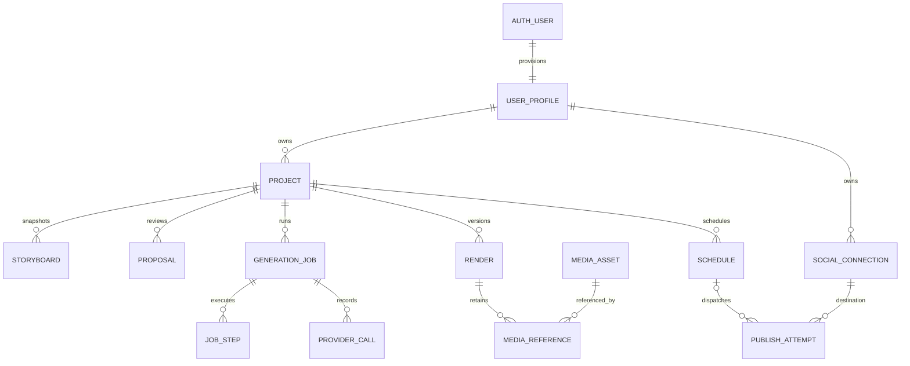

# AI Educational Video Generator — V1 Database Design

**Version:** 1.0 · **Date:** 17 October 2026 · **Status:** Proposed implementation contract  
**Companions:** [API design](AI_Educational_Video_Generator_V1_API_Design.md), [System design](AI_Educational_Video_Generator_V1_System_Design.md).  
**Product source:** supplied `AI_Educational_Video_Generator_V1_PRD.md` v1.0, SHA-256 `68e914d2ecc3d32821cbbe60e654bea1d57570e566a75adc24777e3c0705e9ca`.

This document defines MongoDB Atlas metadata storage and its consistency contract with private R2 media. It does not apply migrations, provision infrastructure or claim the production database already exists. PRD requirements take priority. Proposed defaults are engineering choices requiring implementation validation. The API companion's D01–D11 refine the system design outline; use the exact schemas and state names here when implementing those outlines.

## Contents

1. Persistence boundaries and conventions
2. Ownership, relationships and aggregate boundaries
3. Collections and field schemas
4. Storyboard, visual and media contracts
5. Constraints and enforcement responsibilities
6. State transitions and invalidation
7. Transactions T01–T18
8. Indexes and query patterns
9. Retention, deletion, migrations and recovery
10. Verification and PRD coverage

## 1. Persistence boundaries and conventions

Use MongoDB Atlas replica-set deployment supporting transactions. Domain repositories use the native Node driver. Better Auth owns identity/session/account/verification persistence through its pinned adapter. R2 holds binary audio, MP4, WebVTT, thumbnails and large render manifests. Inngest carries small event identifiers and orchestrates; its run state is not the business source of truth. Catalogs/template contracts are versioned application configuration; persist the versions selected for each job/render. Do not store media blobs, long provider raw responses or user secrets in workflow events.

### 1.1 Field notation and storage rules

`ID` = canonical lowercase UUID string, domain-generated UUIDv7, immutable. `UserID` = opaque Better Auth canonical user string, never coerced to ObjectId. `Date` = BSON UTC Date; wire uses RFC3339. `Hash` = lowercase64-character SHA-256 hex. `Int` = nonnegative safe integer (BSON long where appropriate, serialized with explicit safe-number conversion). `Text(n)` = Unicode string with maximum n Unicode code points; trimmed at documented boundaries only, not normalized destructively. Store human narration after the API’s Unicode NFC and outer-whitespace normalization; preserve interior spacing and meaning. Canonical hashing uses documented serialization separately. Money is integer micro-USD (`costMicros`) or Decimal128, never floating point; any non-USD amount stores currency explicitly.

All domain collections use `_id:ID`, `schemaVersion:Int>=1`, `createdAt:Date`. Mutable records also have `updatedAt:Date` and `resourceVersion:Int>=1` unless their schema explicitly uses `version` instead. Ownership-bearing collections require `ownerId:UserID`. Server assigns IDs, owners, timestamps, versions and states. Required keys are listed; suffix `?` means absent allowed. `null` means explicitly nullable. Unknown fields are rejected in API schemas; DB validators enumerate internal fields and permit only declared fields plus `_id`. Never let undefined/null/absent vary accidentally for an indexed optional value.

Use `version` for profile,connection,proposal,schedule CAS; `revision` for project editorial CAS; `resourceVersion` for job/render/project/attempt polling. Storyboard `version` is monotonic within project, not mutable CAS. Domain documents have a 512KiB application size budget; storyboard target <=128KiB, media manifests <=256KiB. Oversize provider output is rejected before persistence. These application budgets intentionally stay well below MongoDB's document limit.

Dates from services use UTC synchronized clocks, with DB time expressions where possible for leases/due claims. Idempotency, TTL and workflow deadlines always check expiry explicitly; TTL removal is asynchronous cleanup. Soft-deleted entities are excluded by default, but durable tombstones/fences remain for running work and audits.

### 1.2 Transaction assumptions

Use primary read preference, snapshot read concern and majority write concern for multi-document business transactions. Keep transactions short; no Gemini, ElevenLabs, Meta, R2, email, workflow enqueue or render compute inside them. Every participating repository operation receives the same session. Do not run parallel operations on a transaction session. Driver retries can rerun the callback: IDs/input hashes are prepared deterministically before it, and external effects are represented by an outbox record. On uncertain commit, follow driver commit handling and inspect idempotency/aggregate state before deciding to create another command. [MongoDB Node transactions](https://www.mongodb.com/docs/drivers/node/current/crud/transactions/)

## 2. Ownership, relationships and aggregate boundaries



Diagram is logical, not database-enforced foreign keys. Project is the editorial aggregate; immutable storyboard snapshots live separately for history. Jobs/renders/attempts are separate aggregates with explicit links. Scene is embedded in a snapshot; sceneId is stable across versions and scoped to its project. No independent writable scene collection. Do not join a scene by sceneId alone.

All referenced project/storyboard/render/job/asset/connection/proposal/schedule records must belong to the same owner. Cross-owner references are rejected in the transaction. Global music/voice samples are exceptions with `scope:CATALOG`, allowlisted release IDs and license metadata; users cannot write them. Browser endpoints never accept ownerId. Reads include ownership filters even after an earlier authorization check; nested references are checked independently. DB has no native cross-document FK cascade: services and deletion workers implement it.

`Project.activeStoryboardId` points to one immutable snapshot. `Project.latestRenderId` may retain history; `currentRenderId` is set only to a READY render matching the current approved dependency fingerprint. Content edits clear currentRenderId and approval without deleting old assets. Publication history is independent of current editorial status; an edited project can still have a published older version.

## 3. Collections and field schemas

Common fields from §1 apply unless explicitly overridden. Tables list required domain fields in addition to common fields. Every `enum` is closed in the persisted schema for that release. Increment schemaVersion before introducing incompatible shapes; rollout rules in §9.

### 3.1 Identity and preferences

| Collection | Fields and checks | Notes |
|---|---|---|
| Better Auth managed collections | Adapter-defined user,session,account,verification schemas/indexes | Pin package and export actual adapter schema before migration. Never invent/change password hash fields or duplicate sessions into domain collections |
| `userProfiles` | `_id:UserID` (exception to ID), version>=1, displayName:Text(100), timezone:IANA string, defaultVoiceKey:null/voice enum, lifecycle:ACTIVE/DELETING/DELETED, fenceVersion:Int>=1, deletionId:null/ID, emailVerified projection:boolean | Native identity is authority for email/verification. Profile projection may lag and cannot authorize verified-only commands; use trusted session/auth lookup |

Provision profile idempotently from auth hook or lazy reconciliation. Unique _id prevents duplicates. Hook failure does not create a second auth user. Account deletion starts with profile lifecycle fence; native auth deletion occurs through supported adapter APIs after revocation/cleanup coordination. No application credential collection.

### 3.2 Project and immutable editorial history

| Collection | Required fields |
|---|---|
| `projects` | ownerId, revision>=1, resourceVersion>=1, title:Text(120), titleSort:normalized string, originalIdea:Text(5000), refinedIdea:null/Text(5000), audience:null/Text(200), niche:null/Text(200), settings:Settings, nextStoryboardVersion>=1, activeStoryboardId:null/ID, currentSnapshotHash:null/Hash, approval:null/Approval, latestRenderId:null/ID, currentRenderId:null/ID, activeJobId:null/ID, socialCaptionDraft:null/{text:Text(2200),renderId,updatedAt}, warnings:Warning[], lifecycle:ACTIVE/DELETING/DELETED, deletedAt:null/Date, deletionId:null/ID, publishFence:PublishFence, statusProjection:StatusProjection |
| `storyboards` | ownerId,projectId,version>=1,baseRevision>=1,title:Text(120),hook:Text(500),targetDurationSeconds:60–90,visualStyle:trusted enum,compileState:NEEDS_COMPILATION/VALID/INVALID,contentHash:Hash,scenes:Scene[2..16],warnings:Warning[],compilerVersion:null/string,templateCatalogVersion:string,normalizerVersion:string,sourceProposalId:null/ID,sourceJobId:null/ID |
| `proposals` | ownerId,projectId,version>=1,kind:IDEAS/STORYBOARD/SCENE/DURATION_REPAIR/SOCIAL_CAPTION,baseRevision>=1,targetSceneId:null/ID,state:PENDING/APPLIED/DISMISSED/CONFLICTED,payload:typed union,payloadHash:Hash,sourceJobId:ID,appliedStoryboardId:null/ID,appliedAt:null/Date |

Settings: `{voiceKey:null/INDIAN_MALE/INDIAN_FEMALE,captionStyle:CLEAN/BOLD/HIGHLIGHTED,musicAssetId:null/ID,targetDurationSeconds:Int60..90}`. Captions mandatory. Music license and enabled catalog are validated on selection and generation; null means no music. Narration voice must be selected before approval. Approval: `{storyboardId,snapshotHash,approvedBy:UserID,approvedAt:Date}`; approvedBy must equal ownerId in V1. PublishFence: `{epoch:Int,blocked:boolean,activeIntentId:null/ID,reason:null/string}`; epoch increments for relevant invalidations, not a substitute for durable intent locks.

StatusProjection: `{creationStatus,publicationStatus,stale:boolean,computedAt:Date}`. It is derived for listing only, repaired by reconciliation and never used alone to authorize. See §6.4 for exact enums. `titleSort` is an application-computed Unicode-normalized lowercase prefix-search value with a pinned normalization version. Original title remains intact.

Storyboards are append-only: no update/delete except explicit retention purge after references expire. DB roles and repository methods restrict writes; schema validation alone does not enforce immutability. Proposals have immutable payload/hash and mutable state/version. On apply, clone payload to a new storyboard with a server-allocated version and correct project/owner; never trust provider-supplied IDs/owners/versions. Provider content uses a staging schema, not a complete database document.

### 3.3 Jobs, steps, provider calls and renders

| Collection | Required fields |
|---|---|
| `generationJobs` | ownerId,projectId,resourceVersion,kind:API JobKind,state:JobState,active:boolean,stage:API Stage,baseRevision,storyboardId:null/ID,snapshotHash:null/Hash,input:bounded typed immutable command,inputHash:Hash,renderId:null/ID,proposalIds:ID[],retryOfJobId:null/ID,retryRootId:ID,reservationId:null/ID,completedUnits:Int,totalUnits:null/Int,cancelRequested:boolean,lease:{holder:null/string,epoch:Int,expiresAt:null/Date},startedAt:null/Date,finishedAt:null/Date,error:null/SafeError,warnings:Warning[],unsafeToRetry:boolean |
| `renderExecutions` | ownerId,projectId,jobId,renderId,dispatchId:ID,attempt:Int>=1,mode:PREPARE_AUDIO/RENDER,state:QUEUED/RUNNING/SUCCEEDED/FAILED/CANCELLED,providerExecutionName:null/string,leaseEpoch:Int,leaseExpiresAt:null/Date,heartbeatAt:null/Date,callbackSequence:Int,outputPrefix:string,startedAt:null/Date,finishedAt:null/Date |
| `jobSteps` | ownerId,projectId,jobId,stepKey:string<=160,state:PENDING/RUNNING/SUCCEEDED/FAILED/OUTCOME_UNKNOWN/CANCELLED,inputHash:Hash,artifactId:null/ID,attemptCount:Int0..3,lease:{holder,epoch,expiresAt},startedAt:null/Date,finishedAt:null/Date,error:null/SafeError |
| `providerCalls` | ownerId,projectId,jobId:null/ID,publishAttemptId:null/ID,stepKey:string,provider:GEMINI/ELEVENLABS/META,operation:string,callKey:Hash,state:RESERVED/SENT/SUCCEEDED/FAILED/OUTCOME_UNKNOWN,attemptNumber:Int1..3,requestHash:Hash,providerRequestId?:string,responseArtifactId:null/ID,modelVersion:null/string,costMicros:null/Int,usage:null/bounded counts,sentAt:null/Date,finishedAt:null/Date,error:null/SafeError |
| `renders` | ownerId,projectId,jobId,storyboardId,snapshotHash:Hash,renderFingerprint:Hash,state:RenderState,resourceVersion,settingsSnapshot:Settings,resolvedDependencies:ResolvedDependencies,width:1080,height:1920,fps:30,frameCount:null/Int,durationSamples:null/Int,sampleRate:48000,durationSeconds:null/number,alignmentQuality:null/WORD/PHRASE/ESTIMATED,verificationStatus:PENDING/PASSED/FAILED,mp4AssetId:null/ID,captionAssetId:null/ID,thumbnailAssetId:null/ID,manifestAssetId:null/ID,verificationReport:null/bounded checks,error:null/SafeError,readyAt:null/Date |

Provider call requestHash contains only a canonical hash; no keys/tokens. Step artifacts hold reusable successful results. A call can be SENT while a process crashes: mark uncertain until adapter-specific reconciliation; do not assume a missing response means no charge or side effect. Safe retry policy differs for planning/TTS and publishing and must be encoded by adapter. For non-publishing calls, an operator can explicitly settle an unrecoverable ambiguous call and permit a new bounded attempt with duplicate-cost awareness; browser cannot clear unsafeToRetry. Publication requires evidence or manual resolution that never fabricates a successful post.

ResolvedDependencies pins templateVersion,compilerVersion,normalizerVersion,voiceProvider,voiceId,voiceModel,voiceSettingsHash,plannerModelUsed,captionRendererVersion,musicCatalogVersion,musicContentHash:null/Hash,rendererImageDigest,fontBundleHash. Raw voice/provider names are private implementation fields; no API key in this object. Approval hash covers user-approved content/settings and a stable catalog selection version; renderFingerprint additionally covers all actual render dependency versions. A catalog remap cannot silently change an approved voice: invalidate approval or preserve its immutable resolved mapping.

### 3.4 Assets and reference safety

| Collection | Required fields |
|---|---|
| `mediaAssets` | ownerId:null/UserID,scope:USER/CATALOG,projectId:null/ID,kind:AUDIO/ALIGNMENT/VIDEO/CAPTIONS/THUMBNAIL/MANIFEST/VOICE_SAMPLE/MUSIC,state:STAGING/READY/DELETING/DELETED/FAILED,bucketAlias:string,objectKey:string,contentHash:null/Hash,contentType:string,byteLength:null/Int,durationSamples:null/Int,cacheKey:null/Hash,referenceVersion:Int,referenceCount:Int,leaseUntil:null/Date,readyAt:null/Date,eligibleForCleanupAt:null/Date,deleteEpoch:Int,license:null/{catalogId,licenseVersion,attribution},encryptionKeyVersion:null/string |
| `mediaReferences` | ownerId:null/UserID,assetId,refType:RENDER/JOB_STEP/PROPOSAL/CATALOG,refId:ID,projectId:null/ID,retainedUntil:null/Date |

STAGING artifacts have unique attempt-specific keys; never overwrite immutable READY objects. ObjectKey uniquely identifies a stored object in bucketAlias; only service generates it. `referenceCount` is maintained transactionally with references and must equal actual count; reconciler repairs only under a mutation fence. Every insertion/deletion of a reference updates the asset record's referenceVersion/count in the same transaction, serializing against GC. No code path may write references directly. Cleanup requires referenceCount==0, no live transfer lease, retention deadline elapsed, and CAS state READY/FAILED/STAGING → DELETING. New references require READY; DELETING cannot be resurrected. This prevents a delete-versus-attach race.

Signed URL is not stored as canonical asset metadata. Access/ingestion grant extends leaseUntil to at least expiry, in the same checked write, preventing GC during access. Deletion can intentionally override grants to remove owned data; bytes may remain accessible until storage deletion completes. Reference ownership is inherited and validated; global catalog grants require an enabled release entry.

### 3.5 Connections, OAuth, schedules and publication

| Collection | Required fields |
|---|---|
| `socialConnections` | ownerId,version,provider:INSTAGRAM,status:ConnectionState,reserved:boolean,providerAccountId:null/string,username:null/string,accountType:null/string,capabilities:{publishReels:boolean},credentialEnvelope:null/{ciphertext,keyVersion,nonce,tag},tokenExpiresAt:null/Date,grantedScopes:string[],adapterVersion:string,publishFence:PublishFence,lastValidatedAt:null/Date,lastError:null/SafeError,disconnectedAt:null/Date |
| `oauthAttempts` | ownerId,connectionId,expectedConnectionVersion:Int,stateHash:Hash,status:PENDING/EXCHANGING/CONSUMED/FAILED,sessionBindingHash:Hash,returnPath:allowlisted string,pkceEnvelope:null/encrypted object,expiresAt:Date,consumedAt:null/Date,error:null/SafeError |
| `schedules` | ownerId,projectId,renderId,connectionId,version,intentId:ID,caption:Text(2200),dueAtUtc:Date,timezone:string,localDateTime:string,offsetMinutes:signed Int,tzdataVersion:string,state:ScheduleState,activeGuard:boolean,semanticGuard:Hash,projectSnapshotHash:Hash,connectionVersion:Int,republishOfAttemptId:null/ID,publishAttemptId:null/ID,attentionReason:null/string,dispatchLease:{holder,epoch,expiresAt},finishedAt:null/Date |
| `publishIntents` | ownerId,projectId,renderId,connectionId,intentId:ID,source:NOW/SCHEDULE,scheduleId:null/ID,scheduleVersion:null/Int,caption:Text(2200),snapshotHash:Hash,republishOfAttemptId:null/ID,state:OPEN/RESOLVED/UNKNOWN/ABANDONED,active:boolean,projectFenceEpoch:Int,connectionFenceEpoch:Int,latestAttemptId:ID,successfulAttemptId:null/ID |
| `publishAttempts` | ownerId,projectId,renderId,connectionId,intentId:ID,scheduleId:null/ID,sequence:Int>=1,resourceVersion,state:AttemptState,providerContainerId?:string,providerMediaId?:string,permalink:null/httpsURL,submitAuthorization:null/{authorizedAt,projectEpoch,connectionEpoch},submittedAt:null/Date,publishedAt:null/Date,error:null/SafeError,lease:{holder,epoch,expiresAt},safeToRetry:boolean,finishedAt:null/Date |

`publishIntents` is the durable semantic unit across retries. Its immutable input prevents a retry from accidentally selecting a newer caption/render. Identifier intentId is unique per owner and persisted independently of HTTP idempotency expiry. active intent unique indexes enforce one per project AND one per connection. OUTCOME_UNKNOWN keeps intent active indefinitely until resolved; expiring worker lease never expires intent. Schedule creation itself is not a publish submission; schedule semanticGuard prevents multiple live copies of the same project/render/destination. Guard uses owner+project+render+connection; intentional later repost is allowed only after previous successful publication and explicit republishOfAttemptId. Existing live schedules still conflict.

Provider identifiers are optional absent values until known, never null for their partial unique indexes. Provider media ID uniqueness includes connectionId. Account tokens use authenticated envelope encryption with managed keys; key rotation rewraps credentials. Session cookies, OAuth state plaintext and access tokens must never enter logs. Single reserved connection exists even while CONNECTING/EXPIRED/FAILED; DISCONNECTED releases reservation only after active/unknown intent reconciliation, preventing connection replacement from bypassing an uncertain post.

### 3.6 Reliability and operational support

| Collection | Required fields |
|---|---|
| `idempotencyRecords` | ownerId,method,routeKey,keyHash:Hash,requestHash:Hash,operationId:ID,responseStatus:Int,responseBody:sanitized object,state:ACCEPTED/TERMINAL,terminalAt:null/Date,expiresAt?:Date |
| `outboxEvents` | aggregateType,aggregateId,aggregateVersion:Int,eventType:string,schemaVersion:1,payload:{eventId,aggregateType,aggregateId,aggregateVersion,occurredAt,schemaVersion},state:PENDING/CLAIMED/DELIVERED,attempts:Int,nextAttemptAt:Date,lease:{holder,epoch,expiresAt},deliveredAt:null/Date,expiresAt?:Date |
| `inboxEvents` | consumer:string,eventId:ID,aggregateId:ID,state:RECEIVED/APPLIED,appliedAt:null/Date,expiresAt?:Date |
| `admissionReservations` | ownerId:null/UserID,projectId:null/ID,jobId:null/ID,key:string,kind:OWNER_VIDEO/PROJECT_JOB/RENDER_SLOT,active:boolean,unsafe:boolean,leaseEpoch:Int,leaseExpiresAt:null/Date,releasedAt:null/Date |
| `usageBuckets` | ownerId,bucketKey:string,windowStart:Date,windowEnd:Date,limit:Int,reserved:Int,consumed:Int,version:Int,expiresAt?:Date |
| `usageReservations` | ownerId,jobRootId:ID,bucketId:ID,state:RESERVED/CONSUMED/RELEASED,units:1,consumedAt:null/Date,releasedAt:null/Date |
| `rateLimitBuckets` | keyHash:Hash,kind:READ/MUTATION/PLANNING/AUTH,windowStart:Date,windowEnd:Date,count:Int,expiresAt:Date |
| `deletionJobs` | ownerId,scope:PROJECT/ACCOUNT,targetId:string,state:ACCEPTED/CLEANING/WAITING_EXTERNAL/COMPLETED/REQUIRES_ATTENTION,resourceVersion,checkpoints:bounded stage map,blockedIntentIds:ID[],startedAt:null/Date,completedAt:null/Date,error:null/SafeError |
| `auditEvents` | ownerId:null/UserID,actorType:USER/SERVICE/OPERATOR,actorId:string,action:string,aggregateType,aggregateId,requestId:null/string,jobId:null/ID,details:allowlisted bounded object,expiresAt:Date |

Admission reservations implement crash-safe concurrency, not billing. Keys such as `owner-video:<ownerId>`, `project-job:<projectId>`, `render-slot:0` and `render-slot:1` are service-generated. Slots are finite; do not generate unlimited new keys. Project activeJobId and reservations are changed together; reconciliation detects mismatches. Render-slot execution leases can expire, but a stale executor must be fenced/terminated before its physical capacity is assumed free; database CAS alone does not stop a running container. Owner/project reservations remain held for unsafe external calls.

Idempotency stores a sanitized acceptance receipt, never token/grant bodies. keyHash prevents raw client key logging; retain payload hash for conflict detection. Every asynchronous command has operationId linked to its resource. In-flight response can be detected via competing unique insert; transaction winner is the accepted command. Outbox can deliver more than once. Inbox TTL is only safe after aggregate business guards make an old event harmless; no reliance on inbox retention for exactly-once publication.

## 4. Storyboard, visual and media contracts

### 4.1 Embedded Scene

Scene required fields: `sceneId:ID, order:Int0..15, narration:Text(1200), speechText:Text(1200), speechMode:AUTO/OVERRIDE, visualDescription:Text(2000), motionDescription:Text(2000), sceneType:TITLE/PROCESS_FLOW/DIAGRAM/GENERIC_EDITORIAL, estimatedDurationSeconds:number>0, captionHighlights:Text(60)[0..12], compiled:null/CompiledScene, validationErrors:FieldError[]`.

Within each snapshot: sceneIds unique, orders exactly contiguous0..n-1, 2–16 scenes, narration sum<=12000characters, one main idea per scene as review/compiler heuristic. No full timeline editing; ordering comes from accepted generation. CaptionHighlights must exist in displayed text after normalization. Compilation checks speech/display mapping and visual density. Estimated durations are advisory; actual audio duration gates output.

CompiledScene: `{compilerVersion,templateVersion,preview:PreviewConfig,cues:Cue[],speechSpans:SpeechSpan[],layoutWarnings:Warning[]}`. Do not store absolute animation times until audio exists. Cue uses `{id,anchor:{kind:SCENE_START/WORD/PHRASE/SCENE_END,text:null/string,occurrence:Int},targetId,action:REVEAL/HIGHLIGHT/MOVE/COUNT,params:bounded typed object}`. Target IDs must exist in the chosen template. Unknown anchors use an explicit fallback warning; no uncapped arbitrary JS, CSS, SVG or HTML supplied by models.

### 4.2 PreviewConfig discriminated union

| `type` | Fields and bounds |
|---|---|
| TITLE | title:Text(80), subtitle:null/Text(140), iconKey:null/catalog key |
| PROCESS_FLOW | nodes:2–6 `{id,label:Text(40),iconKey:null/key}`, edges:1–8 `{id,from,to,label:null/Text(30)}`, direction:VERTICAL/HORIZONTAL |
| DIAGRAM | nodes:2–8 `{id,label:Text(40),iconKey:null/key,role:PRIMARY/SECONDARY}`, edges:0–12 `{id,from,to,label:null/Text(30)}`, layout:HUB/LAYERS/PAIR |
| GENERIC_EDITORIAL | headline:Text(100), bullets:Text(100)[0..3], emphasis:null/Text(40), iconKey:null/key |

Every union has `accent:BLUE/TEAL/AMBER`, safe predetermined font sizes and spacing chosen by renderer. Every ID unique within scene; all edge endpoints valid; no self-edge unless template explicitly supports it (initial V1 rejects). No remote image URL, arbitrary x/y position or unbounded text. Layout compiler rejects clipping and caption-safe-zone intrusion. TitleScene,ProcessFlowScene,DiagramScene,GenericEditorialScene are the render components implementing these unions; the union can grow only via a versioned schema/catalog rollout. Unsupported requested visual falls back to GENERIC_EDITORIAL with visible review warning, never invents data.

SpeechSpan maps display character range `[start,end)` to speech character range and normalized words, with monotonic nonoverlap and end bounds. Currency/abbreviation normalization preserves meaning. Caption word/phrase times live in immutable alignment artifact as sample offsets; validate sorted nonnegative intervals within decoded audio duration. Audio clock is48kHz PCM. For scene boundary k, cumulativeFrames[k]=round(cumulativeSamples[k]*30/48000); scene frame lengths are differences of successive cumulative boundaries. This avoids accumulated rounding drift. Final manifest includes scene sample/frame boundaries, caption cues, motion cues, source hashes and versions. Verify audio/video duration tolerance <=one frame plus documented encoder padding before READY.

### 4.3 Hashes and reuse

Canonicalization: schema-versioned JSON with sorted object keys, preserved array order, explicit nulls, UTF-8 and stable numeric representation. Do not include createdAt,IDs,revision,job progress,project library title or provider request IDs in content hashes. Storyboard contentHash covers rendered title/hook/scenes/compiled data. Current snapshot hash covers storyboard contentHash + user settings + approved catalog mapping versions. Render fingerprint additionally pins resolved implementation dependencies. Never use JSON object insertion order as the hash contract.

Per-scene audio cache key covers speechText,voiceId/model/settings,normalizerVersion and sample format. Alignment key includes audio hash and display/speech mapping. Visual key includes compiled scene,template/font versions and resolved cue timings. Composition key includes ordered scene artifacts,captions,music license/version,mix settings and renderer build. Change music reuses speech but rerenders composition; change voice invalidates audio/alignment/timing; change visual description retains matching speech; change narration invalidates speech and downstream cues. Cache is owner/project scoped for user content. No cross-tenant content-derived cache lookup or sharing in V1.

## 5. Constraints and enforcement responsibilities

MongoDB schema validators enforce shape/types/enums/local ranges; unique indexes enforce selected uniqueness. Cross-collection consistency and authorization require repository transactions. MongoDB validation should run `validationLevel:strict,validationAction:error` after migration backfill. Do not claim MongoDB enforces foreign keys or immutable fields automatically. [MongoDB schema validation](https://www.mongodb.com/docs/manual/core/schema-validation/)

| Invariant | Enforcer | Failure behavior |
|---|---|---|
| Required fields, types, enum, maxLength/item counts | $jsonSchema plus API schema | Reject write; map client validation to422 |
| revision/version increment and legal transition | CAS filter + transaction | Zero matched → conflict; no blind overwrite |
| Ownership equality across all references | Service lookup in same transaction, owner filters | 404 externally; audit internal violation |
| Unique storyboard version/project, step/job, intent, active locks | Unique indexes §8 | Duplicate key translated to deterministic conflict/replay |
| Unique scene IDs/contiguous order/edge integrity | Snapshot validator before insert |422 with scene JSON pointer |
| approval references exact valid current content | T06 plus T07/T11 recheck |409 approval/stale error |
| audio actual duration, frame count, content integrity | Worker verifier + T08 finalization | Render FAILED, no READY/current pointer |
| no negative usage/refcounts; consumed+reserved<=limit | Conditional update and transaction |429/409; invariant alert if inconsistent |
| immutable accepted snapshots/render inputs | Write-only insertion repositories + restricted DB role, audit | Reject forbidden update |
| no publish duplicate on timeout | Active intent uniqueness + submit journal + reconciliation | OUTCOME_UNKNOWN, hold fence |
| assets not deleted while attaching | Asset referenceVersion CAS and transactional refcount | Retry attach or regenerate artifact |
| no deleted owner/project new work | Shared profile/project fence writes in admission transaction |404/403; workers abort before side effects |

Example local validator skeleton (complete validators must enumerate all fields in §3; this is deliberately not a deployment-ready migration):

```javascript
const renderLocalRules = {
  $and: [
    {$jsonSchema: {
      bsonType: 'object',
      required: ['_id', 'ownerId', 'projectId', 'state', 'width', 'height', 'fps'],
      properties: {
        state: {enum: ['PENDING','PREPARING','RENDERING','VERIFYING','READY','FAILED','CANCELLED']},
        width: {enum: [1080]}, height: {enum: [1920]}, fps: {enum: [30]}
      }
    }},
    {$or: [
      {state: {$ne: 'READY'}},
      {verificationStatus: 'PASSED', durationSeconds: {$gte: 60, $lte: 90},
       mp4AssetId: {$type: 'string'}, captionAssetId: {$type: 'string'}}
    ]}
  ]
};
```

Additional application checks require frameCount between1800 and2700, nonnull valid manifest and assets, audio track and hash verification; local validator does not prove R2 contents. Keep business validation centralized and shared by API/worker, with provider payload validation before it can enter a domain collection.

## 6. State transitions and invalidation

All unspecified transitions are forbidden. Every change uses current state + version/epoch predicates. Terminal records retain history; a retry creates a linked new record, except provider reconciliation can resolve an unknown outcome on the same attempt.

### 6.1 Jobs and renders

| Aggregate / from | Allowed to | Conditions |
|---|---|---|
| Job QUEUED | RUNNING,CANCELLED,SUPERSEDED,FAILED | Claim lease; cancelled before work; stale planning request may supersede; admission failure persisted |
| Job RUNNING | SUCCEEDED,FAILED,CANCEL_REQUESTED,REQUIRES_ATTENTION,SUPERSEDED | Results validated; recoverable input issue/proposal needs review; no unknown paid outcome hidden |
| Job CANCEL_REQUESTED | CANCELLED,REQUIRES_ATTENTION | Worker confirms stop; uncertain effect requires attention |
| Job REQUIRES_ATTENTION | FAILED,CANCELLED | Only service/operator reconciliation settles unsafe outcome; user correction creates new job |
| Job terminal SUCCEEDED/FAILED/CANCELLED/SUPERSEDED | None | Retry creates new ID |
| Step PENDING | RUNNING,CANCELLED | Leased execution |
| Step RUNNING | SUCCEEDED,FAILED,OUTCOME_UNKNOWN,CANCELLED | Provider result or interruption |
| Step OUTCOME_UNKNOWN | SUCCEEDED,FAILED | Verified reconciliation only |
| Step FAILED | RUNNING | Only known safe failure, bounded attemptCount<3 and valid lease |
| Render PENDING | PREPARING,CANCELLED,FAILED | Audio preparation/admission |
| Render PREPARING | RENDERING,CANCELLED,FAILED | Timing and manifest validated |
| Render RENDERING | VERIFYING,CANCELLED,FAILED | Artifact produced |
| Render VERIFYING | READY,FAILED,CANCELLED | Validation and asset commit |
| Render READY/FAILED/CANCELLED | None | Immutable result; stale is computed, not state rewrite |

Job.active is true in QUEUED/RUNNING/CANCEL_REQUESTED; also true in REQUIRES_ATTENTION when unsafeToRetry=true. A duration proposal has unsafeToRetry=false and releases admission; an uncertain paid/provider operation keeps it. Terminal settled states active=false. Cancellation racing final success is resolved by CAS: if success committed first, cancel returns terminal Job; if cancel flag committed first, finalizer cannot mark SUCCEEDED. An old worker epoch can neither update progress nor finalize.

When duration repair is required, mark the associated render FAILED with DURATION_OUT_OF_RANGE while keeping the job REQUIRES_ATTENTION and linking its proposal. Do not leave an abandoned render PREPARING. A new approved generation creates a new render; it can reuse unchanged scene artifacts. Polling stops for attention states and resumes after a user command or explicit status refresh; attention does not mean a worker is still advancing.

### 6.2 Social and scheduling

| Aggregate / from | Allowed to | Conditions |
|---|---|---|
| Connection CONNECTING | CONNECTED,FAILED,DISCONNECTED | Verified OAuth result or cancellation |
| Connection CONNECTED | EXPIRED,REAUTH_REQUIRED,DISCONNECTED | Expiry/revocation/user disconnect |
| Connection EXPIRED/REAUTH_REQUIRED/FAILED | CONNECTING,DISCONNECTED | Explicit reconnect |
| Connection DISCONNECTED | None | New explicit connection record after fences clear |
| Schedule SCHEDULED | DISPATCHING,REQUIRES_ATTENTION,CANCELLED | Due claim; content/token/time problem; user cancel |
| Schedule DISPATCHING | PUBLISHING,REQUIRES_ATTENTION,FAILED | Attempt prepared; final gate fails |
| Schedule PUBLISHING | PUBLISHED,FAILED,REQUIRES_ATTENTION | Confirmed/definite/unknown provider outcome |
| Schedule REQUIRES_ATTENTION | SCHEDULED,CANCELLED | Explicit future reschedule only when no active/unknown attempt |
| Schedule terminal PUBLISHED/FAILED/CANCELLED | None | New schedule required |
| Attempt QUEUED | PREPARING,FAILED,CANCELLED | Admission and manifest |
| Attempt PREPARING | PROCESSING,FAILED,CANCELLED | Provider container created |
| Attempt PROCESSING | READY_TO_SUBMIT,FAILED,CANCELLED | Provider says ready |
| Attempt READY_TO_SUBMIT | SUBMITTING,FAILED,CANCELLED | Atomic final submit authorization |
| Attempt SUBMITTING | PUBLISHED,FAILED,OUTCOME_UNKNOWN | FAILED only conclusive no-publication evidence |
| Attempt OUTCOME_UNKNOWN | PUBLISHED,FAILED | Evidence-based reconciliation; no resend |
| Attempt PUBLISHED/FAILED/CANCELLED | None | Linked retry/new intent according to API |

SUBMITTING persisted before network call deliberately creates a conservative crash window: if process dies before sending, reconciliation must still determine outcome; the replacement worker must not guess and send again. During uncertainty the intent remains UNKNOWN active=true. On known failure set RESOLVED active=false, keep immutable inputs; safe retry reopens same intent under locks and creates sequence+1. Successful intent remains RESOLVED with successfulAttemptId and cannot be retried; intentional repost is a new explicit intent. ABANDONED is allowed only before submit or with conclusive no-post evidence, not to clear ambiguity.

### 6.3 Editorial and invalidation rules

Snapshot NEEDS_COMPILATION/INVALID does not mutate to VALID: compiler creates a new immutable VALID snapshot and switches project pointer conditionally. Historical compileState remains true for that snapshot. Proposal PENDING → APPLIED/DISMISSED/CONFLICTED; CONFLICTED → DISMISSED; APPLIED/DISMISSED terminal. Source payload never changes.

| Change | revision | Approval/current render | Schedules |
|---|---|---|---|
| Library title,audience,niche,refined plan | Increment | Preserve rendered snapshot; PLAN_CHANGED warning for changed idea | Preserve (no output change) |
| Rendered title/hook/scene/speech | Increment | Clear; new snapshot/hash, needs compile as relevant | SCHEDULED→REQUIRES_ATTENTION; fence epoch++ |
| Voice,caption style,music,target duration | Increment | Clear; hash changes; target duration may require recompile | Same invalidation |
| Compile installs valid current output | Increment | Clear; user approves new hash | Same invalidation |
| Approve/revoke approval | Increment | Set/clear approval; revoke clears currentRenderId | Revoke invalidates pending schedules |
| Job progress/new historic result | No; resourceVersion++ | Set currentRenderId only if still approved matching hash | No implicit reschedule |
| Caption draft edit/proposal acceptance | Increment | Video hash/approval unchanged | Existing schedule caption immutable until edited explicitly |

Approval record's hash references content/settings, not project.revision, so a library rename does not stale a render. T07 still requires current R for concurrency. Already DISPATCHING attempts are fenced and rechecked before submit. A submitted post cannot be undone by local invalidation.

### 6.4 Dashboard projections

CreationStatus enum: DRAFT,PLANNING,STORYBOARD_REVIEW,READY_TO_GENERATE,GENERATING,VIDEO_READY,NEEDS_ATTENTION. Precedence: unresolved production attention → NEEDS_ATTENTION; active VIDEO_GENERATE → GENERATING; other active planning → PLANNING; current READY matching approval → VIDEO_READY; valid approved current storyboard → READY_TO_GENERATE; any storyboard/proposal needing user review → STORYBOARD_REVIEW; otherwise DRAFT. Failed job unresolved by subsequent success also shows NEEDS_ATTENTION. PublicationStatus: NOT_PUBLISHED,SCHEDULED,PUBLISHING,PUBLISHED,NEEDS_ATTENTION. Prefer active/unknown attempt, then pending attention, then active schedule, then confirmed history, else NOT_PUBLISHED; UI history preserves published versions even while projection says another state. Never conflate both axes into one editable status.

## 7. Transactions T01–T18

Every command begins with owner/lifecycle checks and request validation. Applicable POST/DELETE commands include unique idempotency receipt and audit insert in the same transaction; successful no-op replay returns existing receipt. Use CAS matched-count assertions, not read-then-unconditional-write. All admission transactions touch the shared project/profile fence so concurrent deletion cannot commit unnoticed after an earlier snapshot read. Implement `fenceVersion` on userProfiles (Int>=1) and increment it on admission/deletion; project uses resourceVersion for this fence. Technical fence writes do not increment profile preference version or project editorial revision.

| ID | Transaction and required atomic writes | Outside transaction / recovery |
|---|---|---|
| T01 | Profile update: owner active + expected version, validate catalog/timezone, update allowed prefs/version | No change to existing projects; auth hook profile upsert by _id is independently idempotent |
| T02 | Project create: active profile fence, defaults, new project, idem receipt,audit | No provider call |
| T03 | Editorial mutation: R CAS; allocate storyboard version if needed; insert snapshot; update pointer/hash/settings/revision/resourceVersion; clear approval/current render when applicable; invalidate pending schedules and increment publish fence; audit | Bounded V1 schedules per project; if fan-out grows replace with epoch invalidation + asynchronous projections. Dispatch must always check epoch regardless |
| T04 | Planning/compile/caption admission: R+active ownership, claim unique project reservation, set activeJobId, insert job, reserve planning usage, outbox,receipt | Provider work only after commit. Retry retains retryRootId and attempt budget |
| T05 | Proposal completion/apply/dismiss: completion checks job epoch, insert immutable payload, settle job/reservation; apply checks R,V,baseRevision, increments project and proposal, creates snapshot if needed, invalidates as T03; compile result installs only unchanged baseRevision | Stale completion becomes CONFLICTED proposal or SUPERSEDED job, never overwrite. Initial generation proposal still needs explicit apply |
| T06 | Approval/revoke: R CAS, current VALID snapshot and settings/hash, set/remove approval, increment revision/resourceVersion; revoke invalidates schedules/fence | No provider calls; authority derived from verified identity |
| T07 | Video admission/cache: R+approval+hash check; if cache READY with full fingerprint attach current reference and receipt; otherwise claim project + owner reservations, reserve daily quota, insert job/render,outbox,receipt; update project activeJobId | Worker prepares scene audio. Cache hit does not consume another quota unit. Daily quota is reserved atomically before external spend |
| T08 | Execution claim/heartbeat/finalize/cancel: job/step epoch+state CAS, counters; finalize verified assets/references/render/job; conditional project currentRenderId only when hash+approval still match; release settled reservations and usage; append outbox/audit as needed | Verification/worker compute occurs outside transaction; stale output retained or cleaned safely; cancellation flags precede cooperative stop |
| T09 | OAuth/connection: reserve connection unique owner; insert hashed-state attempt; callback atomically PENDING→EXCHANGING with expiry/session binding; post-exchange finalize encrypted credential/status/version; refresh/reconnect uses connection CAS | Token exchange outside tx. EXCHANGING crash requires explicit restart/reconciliation, never reuse consumed code. Disconnect fences intent and delegates T18 cleanup |
| T10 | Schedule create/edit/cancel: R/V, current approved READY render, connected version, time validation and semantic guard; immutable pinned render/caption until explicit versioned edit; insert/update schedule + receipt/audit | No provider call; minutely scan dispatches. Edits invalidate old event version |
| T11 | Publish admission/retry: R,current approved render,connection; ensure no semantic duplicate; claim project and connection active intent indexes, set fences, insert attempt with sequence, pin assets, outbox,receipt | Prepare provider container after commit. Safe retry reopens same intent and preserves original input; never retries UNKNOWN |
| T12 | Schedule dispatch: due + SCHEDULED + version CAS + grace check; recheck content/connection/guards; create/reuse exactly one intent and attempt for this schedule version; schedule→DISPATCHING, outbox | Event duplicate loads same attempt. Old version is harmless. Connection busy remains SCHEDULED until grace expires |
| T13 | Publish final submit/result/reconcile: READY_TO_SUBMIT and matching project/connection fences/approval/lifecycle → SUBMITTING with authorization journal; result updates attempt/intent/schedule, provider media uniqueness, audit; unknown retains fences | Actual submit strictly between authorize and result transactions. Lookup reconciliation never submits. Final confirmed result can be recorded after local deletion |
| T14 | Artifact/reference/grant: checked READY/STAGING asset transition, content checksum metadata, attach/detach reference with count/version update; grant extends leaseUntil atomically | R2 write/read outside transaction; only verified existing object may become READY; GC handles orphan uploads |
| T15 | Outbox/inbox: claim due event lease epoch; acknowledge DELIVERED after SDK enqueue; consumer records APPLIED in same business transaction | Crash after send causes duplicate delivery; aggregate guards still required |
| T16 | Quota/admission accounting: conditional bucket increment if reserved+consumed+units<=limit; unique root reservation; consume on first billable external call; release only definite no-spend/cancel | No double credit on retries. Provider usage reconciliation records actual cost separately. Rate buckets use atomic upsert/increment; duplicates retry fetch |
| T17 | Cleanup: claim asset with zero refs, elapsed retention/grant lease and matching referenceVersion; state→DELETING epoch++; finalize DELETED only with same epoch | R2 delete outside transaction, idempotent and retryable. Stuck deletions are reconciled, not resurrected |
| T18 | Deletion/disconnect: lifecycle/fence CAS, deletion job+receipt, cancel queued jobs/future schedules, reject new commands/grants; active/unknown publication retained for reconciliation | Cancel workers; drain refs/assets; revoke credentials/sessions via supported APIs; purge content; retain minimum tombstones/receipts until safe. Never auto-delete already published Instagram posts |

T03 transaction does not replace already executing intent payload. It increments project fence; T13 shares the project write gate, establishing an order between edit and submit authorization. T18 uses the same shared documents. T13 after authorization cannot provide an impossible distributed rollback of an external send; UI must acknowledge this boundary.

### 7.1 Compare-and-swap pattern

```javascript
// Inside the same session as snapshot, outbox and receipt inserts.
const result = await projects.updateOne(
  {_id: projectId, ownerId, lifecycle: 'ACTIVE', revision: expectedRevision},
  {$set: {activeStoryboardId: newSnapshotId, currentSnapshotHash: newHash,
          approval: null, currentRenderId: null, updatedAt: now},
   $inc: {revision: 1, resourceVersion: 1, 'publishFence.epoch': 1}},
  {session}
);
if (result.matchedCount !== 1) throw new RevisionConflict();
```

This is an excerpt, not complete mutation code: also validate same-owner snapshot, invalidate schedules, insert receipt/audit, and use the full T03 recipe. Unique-index violations can mean concurrent valid requests; distinguish expected conflict/replay from infrastructure failures. Never retry a semantic conflict by stripping its expectedRevision.

## 8. Indexes and query patterns

All `_id` indexes are implicit. Define names and option manifests in migrations; use `explain` against production-shaped seeded data before enabling a query. Partial unique constraints apply only to matching documents, so state/active flags are business-critical and must change transactionally. Do not combine sparse and partial options. [MongoDB partial indexes](https://www.mongodb.com/docs/manual/core/index-partial/)

### 8.1 Required index manifest

Key notation follows Mongo order; `+` ascending, `-` descending. U=unique; P=partial filter; TTL=expireAfterSeconds:0 on explicit expiresAt. Names below are stable migration identifiers.

| Collection / index name | Keys | Options / query |
|---|---|---|
| projects / project_owner_updated | ownerId+,updatedAt-,_id- | P lifecycle:ACTIVE; default list |
| projects / project_owner_created | ownerId+,createdAt-,_id- | P lifecycle:ACTIVE; stable sort |
| projects / project_admission_created | ownerId+,createdAt- | F05 rolling creation admission count, includes deleted drafts |
| projects / project_owner_title | ownerId+,titleSort+,_id+ | P lifecycle:ACTIVE; literal prefix/title sort |
| projects / project_creation_filter | ownerId+,statusProjection.creationStatus+,updatedAt-,_id- | P lifecycle:ACTIVE |
| projects / project_publication_filter | ownerId+,statusProjection.publicationStatus+,updatedAt-,_id- | P lifecycle:ACTIVE |
| storyboards / storyboard_version | projectId+,version+ | U |
| storyboards / storyboard_history | ownerId+,projectId+,createdAt-,_id- | History pagination |
| proposals / proposal_history | ownerId+,projectId+,createdAt-,_id- | Optional kind/state postfilter bounded scan |
| proposals / proposal_source | sourceJobId+,kind+ | U; one result of each kind per job |
| generationJobs / job_history | ownerId+,projectId+,createdAt-,_id- | Jobs list |
| generationJobs / job_active_project | projectId+ | U,P active:true |
| generationJobs / job_recovery | active+,lease.expiresAt+ | Reconciler |
| renderExecutions / execution_attempt | renderId+,mode+,attempt+ | U |
| renderExecutions / execution_dispatch | dispatchId+ | U |
| renderExecutions / execution_recovery | state+,leaseExpiresAt+ | Reconcile actual compute before capacity release |
| jobSteps / job_step | jobId+,stepKey+ | U |
| providerCalls / provider_call_key | callKey+ | U |
| providerCalls / provider_request | provider+,providerRequestId+ | U,P providerRequestId {$type:'string'} |
| providerCalls / provider_uncertain | state+,updatedAt+ | Reconciliation |
| renders / render_history | ownerId+,projectId+,createdAt-,_id- | Render list |
| renders / render_cache | ownerId+,projectId+,renderFingerprint+,state+ | Nonunique; choose latest verified READY |
| mediaAssets / asset_object | bucketAlias+,objectKey+ | U |
| mediaAssets / asset_cache | ownerId+,projectId+,kind+,cacheKey+,state+ | Nonunique; ready candidate |
| mediaAssets / asset_gc | state+,referenceCount+,eligibleForCleanupAt+ | GC scans; check lease separately |
| mediaReferences / asset_reference | assetId+,refType+,refId+ | U |
| mediaReferences / reference_reverse | refType+,refId+ | Deletion detach |
| socialConnections / connection_reserved | ownerId+,provider+ | U,P reserved:true |
| socialConnections / connection_expiry | status+,tokenExpiresAt+ | Refresh/reconnect checks |
| oauthAttempts / oauth_state | stateHash+ | U |
| oauthAttempts / oauth_expiry | expiresAt+ | TTL; explicit expiry still checked |
| schedules / schedule_owner_due | ownerId+,dueAtUtc+,_id+ | due_asc |
| schedules / schedule_owner_created | ownerId+,createdAt-,_id- | created_desc |
| schedules / schedule_dispatch | state+,dueAtUtc+,_id+ | Scheduler scan |
| schedules / schedule_project | ownerId+,projectId+,state+ | Invalidate/cancel |
| schedules / schedule_intent | ownerId+,intentId+ | U |
| schedules / schedule_semantic | semanticGuard+ | U,P activeGuard:true |
| publishIntents / intent_owner | ownerId+,intentId+ | U |
| publishIntents / intent_active_project | projectId+ | U,P active:true |
| publishIntents / intent_active_connection | connectionId+ | U,P active:true |
| publishIntents / intent_schedule_version | scheduleId+,scheduleVersion+ | U,P scheduleId {$type:'string'} |
| publishAttempts / attempt_sequence | ownerId+,intentId+,sequence+ | U |
| publishAttempts / attempt_history | ownerId+,projectId+,createdAt-,_id- | List |
| publishAttempts / attempt_media | connectionId+,providerMediaId+ | U,P providerMediaId {$type:'string'} |
| publishAttempts / attempt_reconcile | state+,updatedAt+ | Unknown/submitting monitor |
| idempotencyRecords / idem_scope | ownerId+,method+,routeKey+,keyHash+ | U |
| idempotencyRecords / idem_expiry | expiresAt+ | TTL, only safely terminal records get expiry |
| outboxEvents / outbox_aggregate_event | aggregateType+,aggregateId+,aggregateVersion+,eventType+ | U |
| outboxEvents / outbox_due | state+,nextAttemptAt+ | Dispatch |
| outboxEvents / outbox_expiry | expiresAt+ | TTL after safe delivery retention |
| inboxEvents / inbox_dedup | consumer+,eventId+ | U |
| inboxEvents / inbox_expiry | expiresAt+ | TTL after aggregate guards safe |
| admissionReservations / reservation_active | key+ | U,P active:true |
| admissionReservations / reservation_job | jobId+,active+ | Release/reconcile |
| usageBuckets / usage_window | ownerId+,bucketKey+,windowStart+ | U |
| usageReservations / usage_root | ownerId+,jobRootId+ | U |
| rateLimitBuckets / rate_window | keyHash+,kind+,windowStart+ | U |
| rateLimitBuckets / rate_expiry | expiresAt+ | TTL |
| deletionJobs / deletion_target | scope+,targetId+ | U; one durable deletion per target |
| deletionJobs / deletion_backlog | state+,updatedAt+ | Cleanup/reconcile |
| auditEvents / audit_aggregate | aggregateType+,aggregateId+,createdAt- | Operational history |
| auditEvents / audit_expiry | expiresAt+ | TTL |

`activeGuard` on schedule is true for SCHEDULED,DISPATCHING,PUBLISHING and REQUIRES_ATTENTION; false for PUBLISHED,FAILED,CANCELLED. Attention retains the semantic reservation until user cancels/reschedules, preventing accidental replacement. On unknown publication, publish intent remains separately active even if schedule attention exists. Do not TTL active reservations, provider ambiguity, schedules or lifecycle fences.

Additional indexes for status+kind+pagination combinations should be added only after explain/load tests. Initial bounded postfilter scans can cost more than returned page; enforce a scan/time budget and return continuation based on last scanned record so clients can advance even on an empty page. For project prefix q combined with updated sort, use escaped literal prefix with a bounded owner-scoped candidate set or add a measured index/search strategy before scale; never promise a text relevance search with this prefix API. API v1 supports the filter combinations, so benchmark/restrict beta project counts or add required indexes before rollout, not after unbounded scans reach users.

### 8.2 Keyset queries

For updated-desc page, filter `{ownerId,lifecycle:'ACTIVE',createdAt:{$lte:asOf}}`, plus either `updatedAt<lastUpdatedAt` or `(updatedAt==lastUpdatedAt && _id<lastId)`, sort `{updatedAt:-1,_id:-1}`, fetch limit+1. Signed cursor binds exact filters/sort/owner and expires in30minutes. title_asc uses `(titleSort>lastTitle) OR (= and _id>lastId)`; created_desc uses createdAt/_id; due_asc uses dueAtUtc/_id. Compare IDs as canonical strings with simple collation. Never paginate with skip/offset at scale.

`asOf` excludes newly created rows but does not freeze mutable sort/status values. Documents can move between pages; client deduplicates and refreshes after edits. Cursor is not a database snapshot or export facility. API count query is separate and may lag. Owner filtering must be present even if cursor signature was valid.

### 8.3 Representative partial unique index

```javascript
await db.collection('publishIntents').createIndex(
  {connectionId: 1},
  {name: 'intent_active_connection', unique: true,
   partialFilterExpression: {active: true}}
);
```

Before adding unique indexes, audit duplicates and quarantine ambiguous records; never silently delete user rows to make a build pass. All UUID key collections use simple collation. Confirm target Atlas sharding plan before sharding: these global/partial unique constraints assume the initial unsharded deployment. Sharding is not part of V1 and requires a new uniqueness design.

## 9. Retention, deletion, migrations and recovery

### 9.1 Proposed retention matrix

| Data | Retention and removal |
|---|---|
| Active project/current storyboard/approved render | Until user deletes; no arbitrary TTL |
| Referenced historical media | Retain while used by render/job/schedule/publication evidence |
| Unreferenced staging upload | Eligible after24hours, expired upload lease and no active job |
| Obsolete unreferenced generated artifacts | Eligible after7days; T17 checks refs/grants |
| Terminal idempotency receipt |7days after safely terminal; active/unknown no expiry |
| Delivered outbox/applied inbox | Proposed30days after terminal aggregate; persistent business dedup remains |
| Provider-call/audit metadata |90days proposed; redact content; unresolved calls retained |
| Ordinary operational logs |30days proposed; never credentials/full prompts |
| OAuth attempts |10minute validity; TTL cleanup, consumed state retained only for bounded investigation |
| Rate buckets |24hours after window end |
| Deleted project tombstone/receipt |90days proposed, longer only while external ambiguity remains |
| Account personal content | Delete through verified pipeline; minimize tombstone to non-content IDs/status; backup expiry follows documented backup policy |

No TTL on `usageReservations` before corresponding buckets/retry roots are safely terminal; a maintenance job archives old usage windows with references accounted for. Job/run retention must not remove a referenced artifact or evidence needed to resolve a publish. Minimize provider response retention to identifiers/status/usage; store no raw prompt history beyond the owned snapshot/proposal data needed by product.

### 9.2 Delete sequence and guarantees

1. T18 marks project/account deleting, increments fences and commits a receipt. Reads of the deleted project return404 immediately; deletion receipt remains owner-readable while account active.
2. Cancel queued work and future schedules. Signal running workers; every next step and finalizer checks lifecycle. A worker can have an already in-flight provider call; preserve minimal metadata until settled.
3. Before SUBMITTING, cancel publication. After SUBMITTING/UNKNOWN, keep minimal intent/credential access needed for secure reconciliation, stop new sends, show WAITING_EXTERNAL internally. Do not discard the only evidence and then allow a new connection to republish.
4. Detach references and delete owned media through T17, including late orphan outputs. Recheck bucket prefixes/manifests; never delete shared catalog assets. Retry deletion idempotently.
5. Purge snapshots,proposals,content-bearing metadata and credentials when safe. Complete tombstone/checkpoints. Account deletion revokes all sessions promptly, disables sign-in/new work through profile fence and eventually removes native auth data using adapter-supported methods.

Deleting local data does not remove an already published Instagram Reel. Signed links can remain valid until object deletion; design does not promise immediate global revocation. Backup copies expire on the published backup retention policy; restored backups must replay deletion tombstones before service resumes. Account deletion status is not exposed through an unauthenticated secret URL in V1.

### 9.3 Migration discipline

Version migrations in source control with ID, checksum, owner, expected duration, preflight counts, backup checkpoint, idempotent up/down or explicit forward-only recovery, and verification queries. Keep migration state in a service-only `schemaMigrations` collection `{_id:string,checksum,state:RUNNING/APPLIED/FAILED,startedAt,finishedAt,leaseOwner,leaseExpiresAt,checkpoint}`; unique _id and single migration lease. This operational collection is not product data and has no public API.

Initial sequence: M001 pin/export Better Auth adapter schema and indexes; M002 domain collections + validators in moderate/warn during backfill only; M003 canonical IDs/types and ownership validation; M004 unique/partial indexes after duplicate audit; M005 strict/error validators; M006 seed catalog versions and approved licensed samples; M007 verify outbox/worker/service roles and smoke flows. For a fresh empty deployment, create strict validators immediately; moderate/warn is only for controlled upgrades.

Use expand → deploy compatible readers/writers → bounded resumable backfill → validate/index → contract old shape. Readers support current and immediately previous schema during rollout; writers produce new version. Do not change an immutable snapshot's semantic hash in place; add a new canonicalization version and explicit regenerated snapshot/render. Backfill technical projections separately. New enums deploy readers first, validators next, writers last. Index creation progress/lock impact must be monitored. Never deploy a reader that treats unknown state as success.

POC migration: do not import `.env.local`, API keys, temporary signed URLs, unsupported voices or unreviewed provider data. If sample projects are imported, assign explicit owner,validate every snapshot,copy verified media to private controlled storage and mark approval absent until reviewed. POC files are evidence, not trusted production rows.

### 9.4 Backup, access and disaster recovery

Use Atlas automated backups/PITR appropriate to chosen plan; proposed beta targets RPO<=1hour and RTO<=4hours require measured restore drills and compatible plan. R2 recovery/versioning policy is separate from DB backup: DB restore alone cannot restore deleted media. Retain reproducible manifests and source artifacts for permitted regeneration; do not promise paid providers reproduce byte-identical audio. Validate restored database references against object existence before READY/download/publish is enabled.

Service roles: app can domain CRUD through controlled repositories but cannot manage indexes/users; migration identity can validators/indexes; worker accesses only assigned job assets through service layer; operator actions authenticated/audited; no browser direct Mongo access. Encrypt in transit/at rest, limit network access, keep secrets in secret manager, rotate token-envelope keys with dual-read/single-write version policy. Audit secret reads without logging values.

After outage/restore: pause side effects; reconcile SUBMITTING/UNKNOWN external publication first; restore lifecycle/deletion fences; scan stale job leases and actual container executions; re-drive outbox with aggregate guards; verify usage/admission counts and asset refs; then resume scheduling only within grace. Do not replay all missed schedules or all historical provider calls. Conduct restoration drills using a sandbox social account, never production reposts.

## 10. Verification and PRD coverage

### 10.1 Required invariant and race tests

| Scenario | Required assertion |
|---|---|
| Two tabs edit same revision | Exactly one CAS succeeds; loser retains local edits; no mixed snapshot |
| Apply old AI proposal after manual edit |409; no overwrite; proposal marked conflicted |
| Duplicate generation with same/different keys | Same key same receipt; different keys cannot bypass active job/owner quota |
| Worker crash after provider success/before persistence | Reconcile/reuse where possible; unknown not blindly replayed |
| Cancel races final completion | One terminal outcome by CAS; no cancelled job revived |
| Edit during render | Historical output may finish; cannot become current/publishable |
| Two simultaneous video admissions at daily limit | reserved+consumed never exceeds limit; no negative rollback |
| Duplicate outbox/worker callbacks | No duplicate step output/reference/usage consumption |
| Lease expires while old container still running | Old epoch cannot finalize; capacity reclaimed only after execution fence/stop |
| Publish response lost after external success | OUTCOME_UNKNOWN; no second submit; reconciliation resolves same intent |
| Publish vs edit/delete/disconnect | Shared fence establishes submit boundary; no sends authorized after fence wins |
| Two publish requests on separate projects same account | One active connection intent; other conflicts/waits |
| Schedule edit versus old event | Only current version dispatches; immutable pinned inputs |
| DST gap/fold, late scheduler, expired token | Correct rejection/attention; no silent later publication |
| GC races new media reference/grant | One wins asset write gate; no live reference to deleted object |
| Deletion while late upload arrives | Finalizer rejects attachment; orphan swept; no resurrected project |
| Foreign IDs/cursors/grants | No cross-owner reads/writes/media access |
| Unique-index migration on dirty data | Preflight fails safely; no silent destructive dedup |
| Restore with old outbox and deleted accounts | Fences replayed; no unintended send or content resurrection |

Test with a real transactional Mongo replica set, controllable provider doubles and injected crashes around every external call/commit boundary. Unit tests alone cannot establish transaction/unique-index races. Verify indexes with explain, object cleanup using a disposable bucket, and end-to-end social flow in a permitted test account. Contract tests must compare API DTOs/state enums to persistence mappings, including redaction and nullability.

### 10.2 Coverage and implementation gates

| PRD requirement family | Design location |
|---|---|
| Identity,security,secrets (11,78–79,91) | §1–3.1,3.5,5,9.4; API§3 |
| Plan/editor/approval/versioning (12–23,51–56,83–85) | §3.2,4,6.3,T03–T06 |
| Voice,timing,captions,music,render/storage (24–50,57) | §3.3–3.4,4,T07–T08,T14,T17 |
| Instagram/retry/unknown outcome (58–62,80–82) | §3.5,6.2,T11–T13 |
| Schedule/timezone/token/content changes (63–69) | §3.5,6.2–6.3,T10,T12 |
| Recovery,deletion,logging,performance (70–74,86–89,92–93,97–98) | §3.6,7–10 |
| End-to-end workflow/definition of done (94–96,99–102) | Both docs' verification matrices; system design acceptance gates |

Before implementation: confirm pinned Better Auth adapter field/index schema, hosting/Atlas regions and backup plan, voice/music licenses, Meta login flow/permissions/version, provider retry/reconciliation capabilities, and performance budgets. These are integration/launch checks, not missing permission to write this design. UI design can now map screens to the API companion's states/actions without exposing database/provider internals.

### 10.3 Refinements from the system-design outline

Collection names are finalized here: `planningProposals` → `proposals`, `assets` → `mediaAssets`, `scheduledPosts` → `schedules`, `idempotencyKeys` → `idempotencyRecords`. These are design-name changes, not a claim existing production collections need renaming. `renderExecutions` remains a separate execution journal; worker executionId is its _id. T08 atomically claims/updates the execution and job lease epochs, and completion verifies both. Execution transitions are QUEUED→RUNNING/FAILED/CANCELLED and RUNNING→SUCCEEDED/FAILED/CANCELLED; terminal executions cannot restart. A replacement has a new attempt/dispatch ID and fenced epoch.

The initial template union intentionally specifies four proven base templates. PRD §30 lists recommended richer templates; statistic/comparison/timeline/chart/icon-grid/quote/CTA requests initially map to a faithful supported diagram/editorial representation with a review warning when simplified. A chart requiring unsupported numerical encoding must be rejected or simplified without fabricating data. Add dedicated typed templates through a catalog/schema release before advertising those visual capabilities. Caption safe area, motion anchors and licensed icons remain mandatory for every template.

Content safety is a service/compiler validation boundary before provider work and before proposal adoption; record only policy version and safe rejection code in audit. Do not persist exploit prompts into operational logs. A refusal does not count as successful compilation or clear user approval requirements. Field validation cannot establish factual correctness: the reviewed script remains the creator’s responsibility as specified by the PRD.
