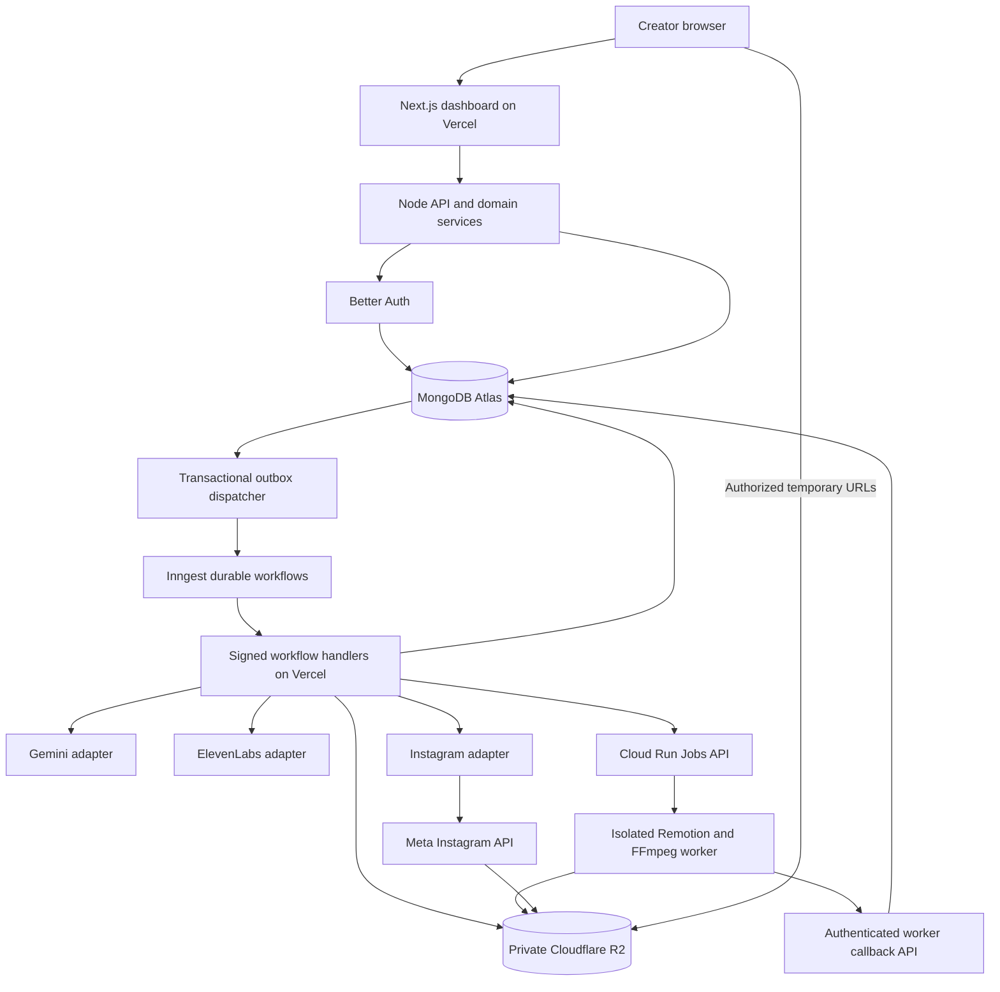
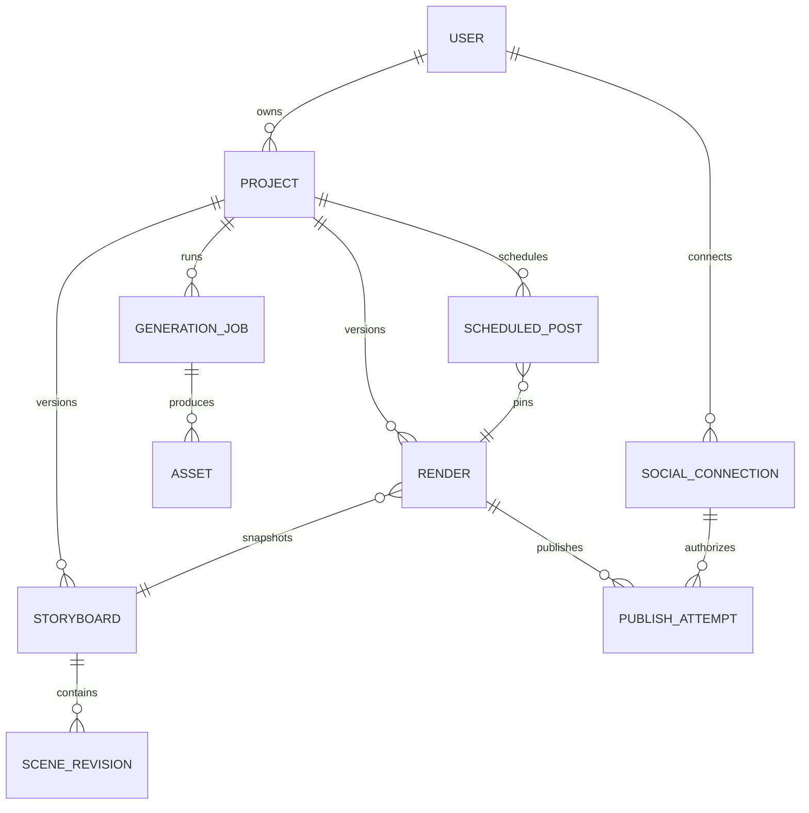
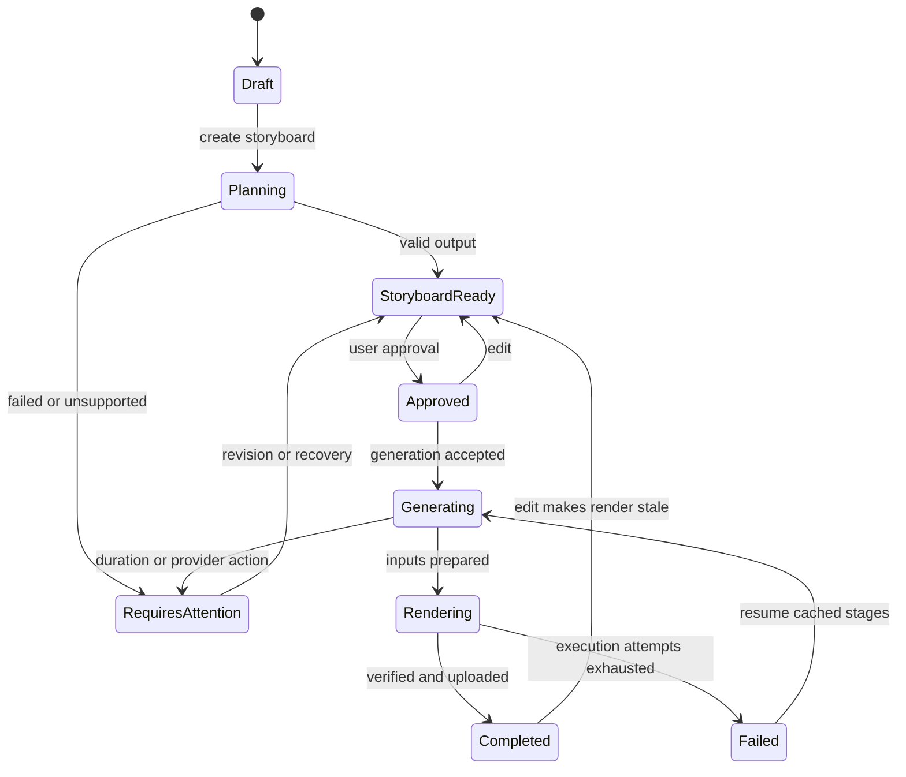
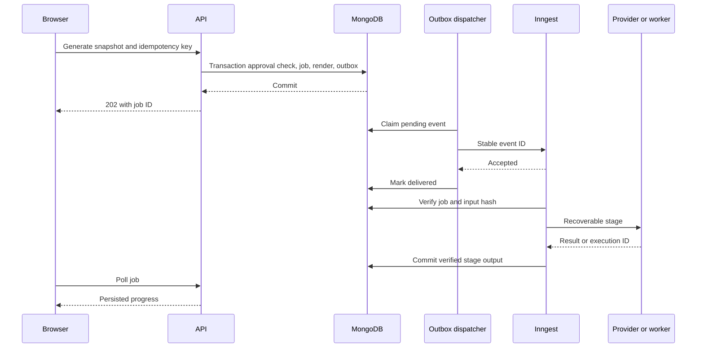
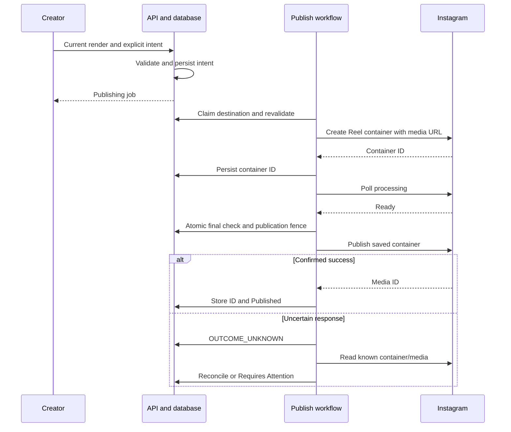

# AI Educational Video Generator — V1 System Design

**Version:** 1.0  
**Date:** 17 October 2026  
**Status:** Proposed implementation baseline, grounded in the finalized V1 PRD  
**Audience:** Product owner, frontend/backend engineers, infrastructure engineers and QA  
**Source of truth:** `AI_Educational_Video_Generator_V1_PRD.md`, version 1.0, supplied by the product owner.  
**Scope:** Dashboard and complete services needed for Plan → Storyboard → Generate → Publish.

This document specifies the system to build. Except for the local video POC, the architecture described here has not been implemented or production-tested. PRD requirements take precedence; items explicitly marked **proposed** are engineering defaults, not previously approved product requirements. No cloud resources, accounts, billing settings or publishing permissions are changed by this document.

## Contents

1. Scope and architectural decisions
2. Existing POC and production gaps
3. System architecture and service boundaries
4. Dashboard and frontend design
5. Domain model, schemas and indexes
6. Versioning, approval and dependency invalidation
7. API contracts
8. Durable workflows and idempotency
9. Storyboard, voice, captions and visual contracts
10. Rendering and media delivery
11. Instagram connection, publishing and scheduling
12. Security and privacy
13. Reliability, failure handling and operations
14. Capacity, performance and cost controls
15. Deployment, configuration and delivery
16. Test strategy and acceptance gates
17. Implementation sequence and open decisions
18. PRD traceability and references

## 1. Scope and architectural decisions

### 1.1 V1 boundaries

Build a desktop-first, responsive, single-owner application. Every authenticated user owns their projects, storyboard revisions, jobs, assets, renders and social connections. There are no teams or workspaces. English narration with two curated Indian-accent voices is the proposed interpretation of the PRD's single-language requirement; do not equate Indian accent with Hindi narration.

Support idea entry/refinement/brainstorming, user-reviewed storyboards, scene edits and regeneration, voice previews, voice-driven motion, mandatory captions, optional licensed music, video preview/download, Instagram professional-account connection, publish now and scheduled publishing. Output is 60–90 seconds, 1080 × 1920, 9:16 MP4; use 30 fps as the engineering baseline established by the POC.

Exclude subscriptions, user-visible credits, billing screens, avatars, voice cloning, multilingual output, team approval chains, public API access, multiple aspect ratios, full timeline editing and automatic fact-checking/citations. Internal cost accounting and operational limits are still necessary. User storyboard approval is part of the core flow, not a team approval workflow.

### 1.2 Decision register

| ID | Decision | Reason and tradeoff |
|---|---|---|
| ADR-01 | Keep Next.js/TypeScript/Node.js on Vercel; a modular monolith for app APIs | One ownership and authorization layer; fewer services to operate. Modules remain separately testable. |
| ADR-02 | Better Auth with its supported MongoDB adapter; native MongoDB driver for domain data | Matches PRD; avoids maintaining a second user/password implementation. |
| ADR-03 | MongoDB Atlas for durable metadata; private R2 for media | Large binary objects never enter database or workflow payloads. |
| ADR-04 | Inngest for durable orchestration, bounded retries, scheduled dispatch and reconciliation | Browser requests only accept commands; database remains the business source of truth. |
| ADR-05 | **Proposed:** Linux Docker render worker on Google Cloud Run Jobs | Keeps Chromium/FFmpeg and long-running rendering outside Vercel request limits. Introduces one extra compute platform. |
| ADR-06 | Per-scene speech and reusable scene artifacts; concatenate/recompose final output | Enables scene-level recovery. Requires testing voice continuity and encoder boundaries. |
| ADR-07 | Immutable storyboard snapshots, explicit approvals and content-hashed dependencies | Reproducibility, stale detection and safe concurrent work; modest storage overhead. |
| ADR-08 | Versioned trusted scene templates; never execute model-generated code | Predictable rendering and bounded visual capabilities. |
| ADR-09 | **Proposed:** Instagram API with Instagram Login, one active Instagram connection per user initially | Small connection UX; adapter must not mix Facebook-Login tokens/scopes with this flow. |
| ADR-10 | Database outbox, worker leases and publication reconciliation | At-least-once infrastructure cannot by itself guarantee exactly-once external effects. |
| ADR-11 | Poll persisted status rather than introduce WebSockets for V1 | Simpler deployment; moderate polling load is acceptable for an initial cohort. |
| ADR-12 | Human storyboard review remains mandatory; POC research mode is disabled by default | PRD explicitly excludes automated fact verification. Model output is not evidence of accuracy. |

No blocking product clarification is needed to write this design. Voice rights, music catalog, hosting region and Meta access are launch gates listed in section 17.

## 2. Existing POC and production gaps

The local `internet-poc` demonstrates deterministic scene mapping, captions, ElevenLabs timestamp alignment and MP4 export. The GPS run produced 2,669 frames / 88.97 seconds, H.264 1080 × 1920 at 30 fps with AAC audio. Its research/storyboard used Gemini 3.8 Flash and its review used the authorized 3.6 Flash fallback after timeouts. Two automatic storyboard repairs were required. This is one observed run, not a reliability benchmark or production SLA.

| POC evidence | Production work still required |
|---|---|
| Title, flow, diagram and editorial layouts work | Extend schema/template registry; measure layout rather than relying on character limits alone |
| Full-script Daniel narration works | Validate Indian Male/Female voice rights and API access; implement scene audio and continuity |
| Local response cache prevents repeated successful calls | Tenant-scoped artifact cache, durable provider-call records and unknown-outcome handling |
| Local files and one generated manifest | R2 storage, immutable revisions, transactions, ownership and cleanup |
| CLI validation and ffprobe checks | Managed workflow, progress API, worker isolation, capacity limits and alerts |
| GPS completed without manual storyboard edits | Mandatory user review; known broad wording and accuracy issues remain in the example |
| No web dashboard or social publishing | Authentication, dashboard, Meta integration and scheduler must be built |

Do not expose the test voice as “Indian Male” without voice validation. Do not ship the POC's fixed eight-scene limit: PRD guidance is 6–12 scenes. Do not move the CLI's `.env.local` or raw response cache into source archives, client bundles or production images.

## 3. System architecture and service boundaries



The database-to-outbox arrow is logical: the dispatcher queries committed records; MongoDB does not directly call Inngest. Meta fetches only a narrowly scoped temporary media URL, not bucket credentials. Workflows run handler code in application compute; Inngest coordinates execution and persisted steps rather than hosting the MP4 render inside its scheduler.

### 3.1 Modules

| Module | Owns | Must not do |
|---|---|---|
| Identity | Better Auth sessions, verification/reset delivery, user deletion request | Custom password/token storage alongside Better Auth |
| Projects | Metadata, revision pointers, approval, optimistic edit control | Call slow providers inside CRUD requests |
| Planning | Idea suggestions, schema validation, scene regeneration proposals | Rewrite approved narration silently |
| Generation | Job orchestration, dependency graph, artifact reuse | Treat a retry as a new user generation |
| Media | R2 metadata, access grants, output verification, deletion | Accept arbitrary remote URLs or bucket keys from clients |
| Rendering | Compile trusted props, scene rendering, audio mix, encode | Fetch user-specified URLs or run generated scripts |
| Publishing | OAuth, schedule state, publish attempts and reconciliation | Blindly retry an uncertain external publish |
| Operations | Logs, internal cost events, quotas, reconciliation | Expose provider tokens or raw prompt payloads in logs |

### 3.2 Runtime placement

CRUD, auth, signed-URL creation and workflow step endpoints use the Node.js runtime, not Edge. Configure a 300-second maximum for the workflow route on a compatible Vercel plan; a single provider attempt has a proposed 120-second deadline, and retries happen as separate durable steps. Confirm actual plan limits before deployment. Vercel documents duration and resource constraints; the application must not assume orchestration removes them. [Vercel function limits](https://vercel.com/docs/functions/limitations)

Render execution uses a prebuilt container, initially 4 vCPU / 8 GiB, one task per job execution, two parallel Chromium frames, a 30-minute deadline and Cloud Run automatic task retries disabled. These are proposed benchmark inputs. Application reconciliation controls retries. Remotion documents a Docker setup with browser dependencies; Cloud Run Jobs provides configurable task resources and deadlines. [Remotion Docker](https://www.remotion.dev/docs/docker), [Cloud Run Jobs](https://cloud.google.com/run/docs/create-jobs)

## 4. Dashboard and frontend design

### 4.1 Routes and behavior

| Route | Screen and primary actions | Data / guard |
|---|---|---|
| `/sign-up`, `/sign-in`, `/forgot-password`, `/reset-password` | Email/password flow, reset feedback | Better Auth; generic reset response prevents email enumeration |
| `/home` | Create Video, recent projects, items requiring attention | Owner-filtered summaries, pagination |
| `/projects` | Search title, filter creation and publishing status, open/delete | Cursor pagination; no media URLs persisted in browser storage |
| `/projects/new` | Topic input or brainstorm; create draft | 5,000-character topic limit |
| `/projects/:id/plan` | Refine/select idea; Create Storyboard | Autosaved idea; asynchronous AI command |
| `/projects/:id/storyboard` | Scene cards, narration, visuals, motion, regenerate, voice sample, approve | Revision token; all pending saves flushed before approval |
| `/projects/:id/generate` | Stage, progress, per-scene failure, retry/cancel | Persisted job; works after reload/logout/login |
| `/projects/:id/publish` | Current MP4, download, caption, account, Publish Now/Schedule | Verified non-stale render and connection required |
| `/scheduled` | Upcoming/attention/completed entries, edit/cancel | Display selected timezone and explicit UTC offset |
| `/connections` | Connect, reconnect, disconnect Instagram | Connection state, expiry and eligible account information |
| `/settings` | Profile, timezone, default voice, delete account | No billing or credits screen in V1 |

A project is the video container, not a workspace. Top-level navigation follows the PRD. Empty states explain the next action; provider failures preserve saved work. Mobile supports review, playback and publishing; scene editing remains desktop-optimized.

### 4.2 Client/server state

Use server-rendered page shells and initial authorized data. Use a query cache such as TanStack Query for background refresh and mutations; validate forms and server requests using shared Zod contracts. These libraries are proposed implementation choices. Never use client-side filtering as authorization.

Autosave after 700 ms idle, one in-flight save per project, with a visible Saving/Saved/Conflict state. A save includes the base revision. On `409 REVISION_CONFLICT`, retain local text and offer reload/compare; do not overwrite another tab silently. Approval waits for save completion. A failed save disables generation and publishing of supposedly current content until resolved.

Poll an active job every 3 seconds while the tab is visible; back off to 15 seconds when inactive and stop at terminal status. Refresh on focus. Use ETag/`If-None-Match` where useful and jitter polling. Progress is stage-based, with actual rendered frame count within rendering; do not invent an overall time estimate. Label fallback timing as reduced precision in review details.

User-visible state has two dimensions: **creation** (Draft/Planning/Storyboard Ready/Generating/Rendering/Completed/Failed/Requires Attention) and **publishing** (Not Published/Scheduled/Publishing/Published/Requires Attention). A published old version may coexist with a newer draft. Do not collapse these into a single destructive status.

Accessibility: semantic controls, keyboard navigation, visible focus, non-color status text, screen-reader live progress announcements at a restrained cadence, accessible validation summaries and reduced motion for dashboard UI. Caption and video safe areas are separately specified in section 9.

## 5. Domain model, schemas and indexes

### 5.1 Storage rules and relationships

Use opaque application IDs consistently, UTC BSON dates, integer media frame counts, explicit `schemaVersion`, and integer revision counters. Better Auth IDs remain in the adapter's native supported representation; domain `ownerId` stores the canonical authenticated user identifier. All queries include owner and live/deletion predicates. Use Atlas transactions for multi-document state plus outbox commits; external calls never execute inside a transaction.



Scenes are embedded in immutable storyboard snapshots in V1; `SCENE_REVISION` above is a logical entity, not a required collection. Stable `sceneId` persists across edits, with a scene-content hash used for artifact reuse. Cap snapshot size at 512 KiB and request JSON at 256 KiB; alignment arrays go to R2.

### 5.2 Collections

| Collection | Important fields |
|---|---|
| Better Auth-managed collections | User, session, account and verification records as required by the pinned adapter; use supported hooks, not custom schema guesses |
| `userProfiles` | `ownerId`, displayName, timezone, defaultVoiceKey, deletionState, createdAt, updatedAt |
| `projects` | `_id`, ownerId, title, originalIdea, refinedIdea, `revision`, `generationSettings`, activeStoryboardId, approvedSnapshotHash, approvedAt, activeJobId, activeRenderId, creationState, publicationFence, deletedAt, createdAt, updatedAt |
| `storyboards` | `_id`, ownerId, projectId, version, baseVersion, source (`AI/USER/DURATION_REPAIR`), scenes[], contentHash, schemaVersion, promptVersion, modelUsed, createdAt |
| `planningProposals` | `_id`, ownerId, projectId, kind (`IDEAS/SCENE/STORYBOARD/DURATION_REPAIR`), baseRevision, targetSceneId?, payload or storyboardId, state (`PENDING/APPLIED/DISMISSED/CONFLICTED`), createdAt, appliedAt |
| `generationJobs` | `_id`, ownerId, projectId, kind, snapshotHash, storyboardId, settingsSnapshot, active, state, stage, stageProgress, cancelRequestedAt, retryOfJobId, leaseEpoch, error, createdAt, finishedAt |
| `jobSteps` | jobId, stepKey, inputHash, status, attemptCount, providerCallId, outputAssetIds, nextRetryAt, leaseOwner, leaseUntil, error |
| `providerCalls` | ownerId, jobId, stage, requestHash, provider, model, state, externalRequestId, submittedAt, completedAt, responseAssetId, estimatedCost, actualUsage; never plaintext credentials |
| `assets` | `_id`, ownerId, projectId, sceneId, type, objectKey, sha256, bytes, mimeType, durationSamples, sampleRate, dependencyHash, state, createdAt, eligibleForDeletionAt |
| `renders` | `_id`, ownerId, projectId, storyboardId, snapshotHash, settingsHash, rendererBuildId, manifestAssetId, videoAssetId, thumbnailAssetId, subtitlesAssetId, state, fps, frames, verification, createdAt |
| `renderExecutions` | renderId, attempt, dispatchId, providerExecutionName, state, leaseEpoch, leaseUntil, heartbeatAt, progress, callbackSequence, outputPrefix |
| `socialConnections` | `_id`, ownerId, provider, accountId, username, scopes, tokenCiphertext, encryptionKeyVersion, expiresAt, lastValidatedAt, status, version |
| `scheduledPosts` | `_id`, ownerId, projectId, renderId, snapshotHash, connectionId, caption, dueAtUtc, timezone, localDateTime, offsetMinutes, scheduleVersion, state, publishAttemptId, lastError |
| `publishAttempts` | `_id`, ownerId, projectId, renderId, connectionId, scheduleId?, scheduleVersion?, intentId, state, containerId, externalMediaId, permalink, submittedAt, lastReconciledAt, error |
| `outboxEvents` | `_id` (event ID), aggregateId, aggregateVersion, type, minimal payload, availableAt, status, leaseUntil, attempts, sentAt |
| `idempotencyKeys` | ownerId, action, key, requestHash, resourceId, responseStatus, expiresAt |
| `auditEvents` | actorId, resourceType, resourceId, action, requestId, safe metadata, timestamp, expiresAt |

`generationSettings` includes voiceKey, voiceConfigVersion, speechModelVersion, captionStyleVersion, musicAssetId or null, templateRegistryVersion and layoutVersion. Render-affecting settings participate in the snapshot hash. Published historical render IDs remain in publish records even after `activeRenderId` changes.

### 5.3 Required indexes

| Collection | Index / constraint |
|---|---|
| `projects` | `{ownerId:1, deletedAt:1, updatedAt:-1, _id:-1}`; prefix/title search index scoped by owner |
| `storyboards` | Unique `{projectId:1, version:1}`; `{ownerId:1, projectId:1, createdAt:-1}` |
| `planningProposals` | `{ownerId:1, projectId:1, state:1, createdAt:-1}` |
| `generationJobs` | Partial unique `{projectId:1}` where `active:true`; `{ownerId:1, createdAt:-1}`; `{state:1, updatedAt:1}` |
| `jobSteps` | Unique `{jobId:1, stepKey:1, inputHash:1}` |
| `providerCalls` | `{ownerId:1, requestHash:1, state:1}`; `{state:1, submittedAt:1}` |
| `assets` | Unique `{objectKey:1}`; `{ownerId:1, projectId:1, dependencyHash:1, state:1}`; `{state:1, eligibleForDeletionAt:1}` |
| `renders` | `{ownerId:1, projectId:1, createdAt:-1}`; `{projectId:1, snapshotHash:1, state:1}` |
| `renderExecutions` | Unique `{renderId:1, attempt:1}`; unique dispatchId; `{state:1, leaseUntil:1}` |
| `socialConnections` | Partial unique `{ownerId:1, provider:1}` for active connection; unique provider/account binding if cross-user reuse is disallowed |
| `scheduledPosts` | `{state:1, dueAtUtc:1}`; `{ownerId:1, dueAtUtc:1}`; partial unique active post intent |
| `publishAttempts` | Unique `{ownerId:1, intentId:1}`; partial unique `{connectionId:1}` where active publication is true; sparse unique `{provider:1, externalMediaId:1}` |
| `outboxEvents` | `{status:1, availableAt:1}`; ID is unique |
| `idempotencyKeys` | Unique `{ownerId:1, action:1, key:1}` and TTL on expiresAt |
| `auditEvents` | `{resourceId:1, timestamp:-1}` and retention TTL |

Add all fields used by indexes to implementation schemas, including `updatedAt` and explicit active flags. TTL deletes are asynchronous and never used to enforce authorization, expiry or media cleanup. Expiry is checked by application logic. Validate indexes with representative query plans; no collection scans for dashboard or due schedules.

Better Auth supports MongoDB through its adapter; pin the compatible package version and generate/verify its required indexes during setup. Application transactions use the same Atlas deployment but remain separate from the adapter's internals. [Better Auth MongoDB adapter](https://better-auth.com/docs/adapters/mongo)

## 6. Versioning, approval and dependency invalidation

### 6.1 Revision and approval invariants

1. Every edit produces a new immutable storyboard snapshot or render-settings revision. The project pointer advances atomically with its `revision`.
2. Approval captures a hash of the exact storyboard, normalized speech plan and generation settings. It is invalidated by content, voice, motion, music or caption changes.
3. Generation snapshots that approved hash. Workers never follow mutable “latest” pointers while generating.
4. An old job may finish after a newer edit; save its output as an older version, but promote it to `activeRenderId` only if the project's current hash still matches.
5. Publishing and scheduling require a completed, verified, current render. A stale output can still be previewed/downloaded with a clear version label.
6. No duration correction can silently replace user-approved narration. Generate a revision proposal, mark Requires Attention, and obtain fresh approval before replacement speech.

This resolves the tension between automatic duration correction in PRD §25 and explicit storyboard approval in §5. The correction can be automatic; accepting changed words remains a user action.

### 6.2 Dependency graph and hashes

```text
idea + promptVersion + model → storyboard revision
speechText + voiceConfig + model + normalization + neighbor context → scene audio
scene audio hash + alignmentVersion → speech timing
narration/speech mapping + timing + caption style → captions
visual/motion config + asset hashes + template version + local timing → scene video
ordered scene artifacts + audio mix + music + encoding profile → final render
final render + caption + destination + explicit intent → publish attempt
```

Use SHA-256 over canonical JSON with sorted keys; include schema and adapter versions. Cache lookup is tenant/project scoped. Do not deduplicate private content across owners. Reuse requires COMPLETE status and verified object existence/hash. A provider seed does not guarantee deterministic speech; cache actual returned bytes.

| Change | Invalidate | Reuse |
|---|---|---|
| Narration/speech | Changed scene audio/timing/captions/video, final mix/render, approval | Unchanged independent scene artifacts |
| Neighbor text used as TTS context | Neighbor speech cache keys too | Audio whose complete input hash is unchanged |
| Visual/motion only | Changed visual assets, scene clip, final render, approval | Speech and timing |
| Voice/model settings | All speech, timing, captions, scene clips, final render, approval | Static visual assets |
| Caption style | Captions/scene clips/final render, approval | Speech and source assets |
| Music selection | Final mix/render, approval | Scene clips and narration |
| Scene reorder | Context-sensitive speech where applicable, global timeline/render, approval | Independent local-time scene artifacts |
| Instagram caption/time | Publication intent/schedule revision | Render |

When regeneration returns, compare its base revision before applying. If the user edited meanwhile, retain an unapplied suggestion and offer comparison; never replace later edits. Whole-storyboard regeneration requires confirmation when manual edits exist. Keep snapshots internally without promising a full version-history UI in V1.

### 6.3 State transitions



Jobs separately terminate as SUCCEEDED, FAILED, CANCELLED, SUPERSEDED or REQUIRES_ATTENTION. Publication follows QUEUED → PREPARING → PROCESSING → SUBMITTING → PUBLISHED, with FAILED, REQUIRES_ATTENTION and OUTCOME_UNKNOWN branches. Retries must not erase the prior external outcome.

## 7. API contracts

### 7.1 Conventions

Application prefix `/api/v1`; Better Auth owns `/api/auth/*`. JSON success contains `data` and `requestId`; errors contain `{error:{code,message,fieldErrors?,retryable},requestId}`. Return sanitized explanations rather than provider payloads.

All mutations validate session, ownership, origin/CSRF as appropriate, body and rate limits. `Idempotency-Key` is required for expensive AI commands, generation, publish and schedule creation. Reusing a key with a different normalized request returns 409 IDEMPOTENCY_CONFLICT. Keep key responses for a proposed seven days; persistent job/intent records continue deduplication afterward. Use `If-Match` or `expectedRevision` for edits/approval.

Return 200/201 for small completed operations; 202 plus resource/status URL for background work; 400 malformed input; 401 expired session; 404 missing/not-owned resource; 409 version/state conflict; 422 unsupported content/duration; 429 admission limit; 503 temporary service health failure. Provider billing faults become `PROVIDER_BILLING_BLOCKED` internally, with a user message that work is saved and generation is temporarily unavailable.

### 7.2 Endpoint inventory

| Method and path | Request / response |
|---|---|
| `POST /projects` | `{title?,idea}` → draft ID/revision |
| `GET /projects?cursor=&limit=&status=&q=` | Owner summaries; default 20/max 50; nextCursor |
| `GET /projects/:id` | Revision, approval, stale flag, job/render summaries |
| `PATCH /projects/:id` | Expected revision, permitted metadata/settings → new revision |
| `DELETE /projects/:id` | Confirmed deletion → 202 cleanup ID |
| `POST /projects/:id/ideas` | Brainstorm/refine, input, audience → planning job |
| `POST /projects/:id/storyboards` | Expected revision, replaceConfirmed → job |
| `GET /projects/:id/storyboard` | Immutable snapshot/editable projection |
| `PATCH /projects/:id/scenes/:sceneId` | Revision, narration/visual/motion text → snapshot |
| `POST /projects/:id/scenes/:sceneId/regenerate` | Revision, guidance ≤2,000 characters → proposal job |
| `POST /projects/:id/proposals/:proposalId/apply` | Expected revision, selected idea or proposal ID → atomically apply and invalidate prior approval |
| `POST /projects/:id/proposals/:proposalId/dismiss` | Mark proposal dismissed without changing current content |
| `POST /projects/:id/approve` | Revision, snapshot hash → approval receipt |
| `GET /voices` | Curated logical voices, availability, cached samples |
| `POST /projects/:id/generations` | Approved snapshot hash → job/render IDs |
| `GET /jobs/:id` | Stage, counts, failed scenes, error, allowed actions |
| `POST /jobs/:id/retry` | Resume eligible work; reject unknown side effects |
| `POST /jobs/:id/cancel` | Cooperative cancellation; no refund promise |
| `GET /renders/:id` | Verification, version/stale state, metadata |
| `POST /renders/:id/access` | Preview/download purpose → temporary URLs |
| `GET /connections` | Labels/status/expiry, never tokens |
| `POST /connections/instagram/start` | OAuth state → authorization URL |
| `GET /connections/instagram/callback` | Server validates/exchanges provider code/state |
| `DELETE /connections/:id` | Disconnect; pending schedules require attention |
| `POST /renders/:id/social-caption` | Caption suggestion, never automatic publish |
| `POST /renders/:id/publish` | Connection, caption, intentId, revision → attempt |
| `GET /publish-attempts/:id` | State, permalink if known, recovery options |
| `POST /publish-attempts/:id/reconcile` | Read/reconcile job, not new publication |
| `POST /schedules` | Render, destination, caption, local time, IANA zone/offset → schedule |
| `GET /schedules` | Owner/date/state filters; cursor pagination |
| `PATCH /schedules/:id` | Schedule version; time/caption/new-render changes |
| `DELETE /schedules/:id` | Cancel before publication point of no return |
| `POST /account/deletion` | Confirmed deletion, revoke sessions |

Internal routes: `/api/inngest` for signed workflow delivery; `/api/internal/render-events` for authenticated worker status/results; signed, deduplicated provider webhooks. These are not a customer public API.

### 7.3 Example generation command

```http
POST /api/v1/projects/proj_example/generations
Idempotency-Key: 3d68baf2-example
Content-Type: application/json

{"approvedSnapshotHash":"sha256:example","expectedRevision":12}
```

```json
{
  "data": {
    "jobId": "job_example",
    "renderId": "render_example",
    "state": "QUEUED",
    "statusUrl": "/api/v1/jobs/job_example"
  },
  "requestId": "req_example"
}
```

In one transaction check approval/revision, reuse a complete matching render if present, enforce one active generation per project, create job/render and insert outbox event. Concurrent identical requests receive the existing job. Different-snapshot requests while a job is active get 409 and cancel/wait options.

## 8. Durable workflows and idempotency

### 8.1 Transactional dispatch



Best-effort dispatch after commit reduces latency; an Inngest cron scans pending outbox records every minute. If send succeeds but marking delivered fails, resend the same ID. Consumers also claim business keys because event deduplication windows are finite. During Inngest outages the outbox survives and catches up after recovery. Alert when oldest pending event exceeds five minutes.

### 8.2 Workflow catalog

| Function/event | Durable work |
|---|---|
| `idea/plan.requested` | Input check → provider → structured suggestions → persist; no automatic topic selection |
| `storyboard/create.requested` | Generate → validate → bounded repair → proposal → compare/apply base revision |
| `scene/regenerate.requested` | Neighbor context → single replacement → continuity check → apply only target |
| `video/generate.requested` | Approval → scene speech reuse/generation → timing → duration gate → assets → manifest → dispatch render → observe/verify/finalize |
| `render/retry.requested` | Inspect execution/artifacts; resume failed render/upload |
| `instagram/publish.requested` | Validate → media grant → container → processing → final fence → submit → reconcile |
| Schedule cron | Claim due records → unique intent/outbox in transaction |
| Maintenance cron | Outbox, stale leases, uncertain calls, token status, cleanup, overdue schedules |
| `project/delete.requested` | Tombstone/cancel → reconcile external work → delete media → finalize cleanup |

Step returns contain IDs, hashes and small metadata; binary audio and alignment live in R2. Stable step names incorporate scene ID and input hash. Inngest persists successful steps and supports concurrency controls, but does not make an unrecorded external side effect safe to repeat. [Durable execution](https://www.inngest.com/docs/durable-execution/concepts), [concurrency](https://www.inngest.com/docs/durable-execution/flow-control/concurrency)

### 8.3 Retry ownership and uncertain outcomes

One layer owns retries for each side effect. Disable SDK retries when orchestration owns them. Proposed transient policy: initial call plus two retries, jittered 5/20-second delays and `Retry-After`, then attention or tested fallback. Invalid model output gets at most two repair requests, separately counted from transport retries. Models come from an operator allowlist; record actual model used.

Persist intent before provider submission. A crash after submission but before result commit creates OUTCOME_UNKNOWN. Retrieve by documented provider request/history facilities if available. Otherwise do not claim exactly-once billing: record uncertain cost and permit at most one budgeted regeneration under operator policy, or require intervention. Instagram always follows the stricter reconciliation rules in section 11.

401/403 credentials, 402 billing, removed voices, policy refusal and authorization errors do not trigger blind retries/model hopping. A provider circuit breaker stops new requests during account billing outages. Customers do not supply their own provider keys.

### 8.4 Cancellation and concurrency

Proposed launch caps: one active generation per user/project, two scene TTS requests per job, two global render executions, one active publish per Instagram connection. Persisted slot leases limit detached render executions; Inngest step concurrency alone cannot cap jobs after dispatch returns.

Check cancellation/deletion before expensive stages and on heartbeat. Already submitted work may finish but cannot publish/promote deleted content. Use compare-and-set leases and increasing fencing epochs. Heartbeat every 15 seconds; two-minute staleness triggers investigation, not immediate duplicate execution. Query Cloud Run before replacing a worker; terminate or prove the old execution ended before reusing its slot.

## 9. Storyboard, voice, captions and visual contracts

### 9.1 Versioned domain contract

This is the contract outline; implementation must validate every discriminated template payload at runtime.

```ts
type VoiceKey = 'INDIAN_MALE' | 'INDIAN_FEMALE';
type SceneType = 'TITLE' | 'PROCESS' | 'DIAGRAM' | 'EDITORIAL'
  | 'STATISTIC' | 'COMPARISON' | 'TIMELINE' | 'CHART'
  | 'ICON_GRID' | 'ILLUSTRATION' | 'LABEL_REVEAL'
  | 'CALLOUT' | 'BULLET_STEP' | 'QUOTE' | 'CTA';
type SpeechSpan = { id: string; displayText: string; speechText: string };
type Cue = { spanId: string; spokenPhrase?: string; occurrence?: number };
type Motion =
  | { type: 'REVEAL' | 'HIGHLIGHT'; targetId: string; cue: Cue }
  | { type: 'CONNECT'; from: string; to: string; cue: Cue }
  | { type: 'COUNTER'; targetId: string; from: number; to: number; cue: Cue };
type Scene = {
  sceneId: string;
  order: number;
  narration: string;
  speechText: string;
  speechSpans: SpeechSpan[];
  sceneType: SceneType;
  visualDescription: string;
  motionDescription: string;
  templateConfig: Record<string, unknown>; // replace with template union
  motionPlan: Motion[];
  captionHighlights: string[];
  estimatedDurationSeconds: number;
};
type Storyboard = {
  schemaVersion: '1.0';
  title: string;
  hook: string;
  targetDurationSeconds: number;
  visualStyle: 'minimal_editorial';
  scenes: Scene[];
};
```

Keep editable visual/motion descriptions separate from compiled props. Description edits regenerate configuration as a proposal; the renderer never interprets natural language at runtime. Validate IDs, edge targets, numeric/chart data, element bounds, cue occurrence and asset ownership. Do not decorate categories with arrows that imply false causal relationships.

Plan for 70–80 seconds using voice-specific speaking-rate estimates, not the POC's universal word-count gate. Recommend 6–12 scenes; proposed absolute technical bounds are 2–16, with warnings for scene durations outside 5–12 seconds and requests to simplify pathological cuts. Eight scenes is a default, not a requirement. Final output still must be 60–90 seconds.

### 9.2 Registry and visual layout

Each template declares schema, semantic constraints, version, local assets, element limits, measured text boxes and supported motion. Map current TITLE/PROCESS/DIAGRAM/EDITORIAL implementations directly; add STATISTIC and COMPARISON next. Other PRD-recommended types may use explicit semantic mappings until native templates pass QA. A fallback must preserve meaning and be visible in storyboard preview; otherwise request a revised visual.

Use light background, dark text, restrained green/orange accents, one vector family and bounded motion. Proposed 1080 × 1920 geometry: 84 px side margins, visual area ending y=1450, captions y=1510–1780, no critical text in the bottom footer. Test against current Instagram overlays on real devices; these are POC values, not guaranteed platform safe areas. Proposed minimums: captions 42 px, labels 28 px, secondary text 24 px, generally 2–5 primary elements. Bundle fonts/icons and wait for font readiness.

Handle text by wrapping → shortening secondary copy with a visible revision if meaning changes → shrinking within minimums → actionable layout failure. Never clip or silently omit important labels. Missing decoration may fall back to vectors; substantive diagrams cannot become unrelated images. Render-side bounding-box checks supplement schema length limits.

### 9.3 Voice and continuity

Logical voice keys map server-side to licensed voice IDs, models, settings and pronunciation rules. Persist the resolved snapshot. Cache preview samples rather than generating on each click. Removed voices require a new selection; never silently change accent/gender.

Generate scene speech with consistent settings and supported neighbor context. Cache keys include that context. ElevenLabs provides timestamped speech and continuity inputs; contract-test fields against the chosen model. Store original and normalized alignment separately. [ElevenLabs timing API](https://elevenlabs.io/docs/api-reference/text-to-speech/stream-with-timestamps/)

Decode to a consistent proposed 48 kHz PCM sample rate for assembly; measure decoded samples and account for MP3 delay. Add small explicit scene gaps only as needed; do not crossfade syllables. Test natural continuity before adopting scene speech in production. A full-script fallback can exist as an explicit mode, but its narration edits invalidate the entire audio track.

Decoding, probing and normalization run in the Cloud Run worker's `PREPARE_AUDIO` mode, not inside the Vercel request handler. After scene TTS outputs are persisted, Inngest dispatches this preparation task, observes its durable result, and applies the duration gate before dispatching `RENDER` mode. Both task kinds use the same image, execution/lease/callback protocol and bounded compute slots. Persist normalized audio and its measured manifest in R2 so render retries do not repeat preparation. This adds a short compute phase but gives the duration decision actual decoded-sample measurements.

### 9.4 Speech/display mapping

`narration` is displayed wording; `speechText` is submitted verbatim. A versioned normalizer produces ordered semantic spans: display `₹1,00,000` → spoken `one lakh rupees`. Map timing through spans, taking the union of spoken intervals for a single display token. Never use character positions from one string to index another. Repeated cues identify their span/occurrence rather than the first substring match.

Validate finite nonnegative times, monotonic starts, end ≥ start, text identity against the correct original/normalized stream and end within decoded-duration tolerance. Preference: exact words → measured sentence/phrase timing → duration-weighted estimated phrases. Estimated mode keeps captions renderable, disables misleading word highlighting, records `alignmentQuality=ESTIMATED` and shows a preview notice. Approximate timing is not labeled measured synchronization.

Use sample time for audio and integer frames for visuals. Derive boundaries from cumulative sample positions, then round; do not sum independently rounded scene durations. Captions and motion are local to a scene. Clamp motion to available frames, hold meaningful final states for longer speech and end captions by the last spoken sample.

### 9.5 Duration correction

Measure complete timeline including gaps/padding. Within 60–90 seconds, proceed. At 58–60 or 90–92 seconds, adjust optional non-speech padding first. If insufficient, propose edited narration and return for approval. Do not clip, add unnatural silence or silently time-stretch. Material mismatches always require a proposal. Limit repair proposals to one per generation cycle; after reapproval reuse unaffected speech and recompute offsets.

### 9.6 Captions, assets and music

Clean captions are the default; Bold/Highlighted can be versioned options. Break by measured width and phrase boundaries, not fixed seven-word groups; at most two lines, with tests for rapid speech and long terms. Burn captions into MP4 and optionally export SRT/VTT from the same source.

Built-in vectors/icons are the dependable V1 asset provider. A future approved raster provider can implement `AssetProvider`, but paid image generation is not a launch dependency. V1 exposes neither arbitrary remote URLs nor stock marketplaces/user uploads.

Music defaults to None. Include at least one cleared catalog track to deliver basic support; verify commercial render and Instagram rights. Mix after scene assembly with voice priority, fades and ducking. Proposed targets are approximately -16 LUFS program loudness and ≤ -1 dBTP true peak, with music initially around 18 dB below speech and listening tests. These are engineering targets, not asserted Instagram requirements.

## 10. Rendering and media delivery

### 10.1 Execution contract

Immutable manifests contain scene speech/asset IDs and hashes, timing, captions, trusted props, ordered scene clips, music, output profile and renderer build. Cloud Run receives an execution ID and narrow worker credential/reference, never arbitrary source, shell commands or user URLs.

1. Authenticate to internal API, claim execution and fetch authorized manifest.
2. Obtain scoped object access, download inputs to a local task directory and verify checksums.
3. Reuse scene clips by dependency hash; render changed scenes with local timing.
4. Assemble consistent codec/timebase clips. Cuts/fades remain within scenes; cached clips have no cross-scene visual dependency.
5. Assemble speech by sample position, mix music, encode H.264 yuv420p/AAC, constant 30 fps, 1080 × 1920, faststart playback.
6. Probe streams, frame count, dimensions, duration, decodeability and captions against speech.
7. Upload MP4/thumbnail/subtitles to attempt-specific staging keys; verify size/hash.
8. Callback with execution ID, epoch, monotonic sequence and checksums; only the current lease may finalize.
9. Promote only if project snapshot still matches. Clean local files on exit.

Final assembly may re-encode the full composition even when scenes are reused. Scene regeneration promises reuse of unaffected work, not zero assembly cost. Verify frame/audio continuity; stream concatenation is not assumed seamless.

### 10.2 Dispatch and callback recovery

Reserve execution record/slot before dispatch and persist the returned Cloud Run execution name. If the response is lost, query executions and correlate claims by dispatch ID before launching again. Duplicate executions must lose the lease before expensive rendering.

Callbacks use short-lived credentials bound to execution and allowed operations, with sequence/nonce replay checks. Callback failure leaves retryable staged objects. Inngest polls database execution state and reconciles Cloud Run status; completion cannot depend solely on an event that might arrive before a wait starts. Reject old-epoch callbacks.

### 10.3 R2 keys and access

```text
users/{ownerId}/projects/{projectId}/audio/{sceneId}/{dependencyHash}.wav
users/{ownerId}/projects/{projectId}/alignment/{dependencyHash}.json
users/{ownerId}/projects/{projectId}/assets/{assetId}/{sha256}.{ext}
users/{ownerId}/projects/{projectId}/scenes/{rendererBuild}/{dependencyHash}.mp4
users/{ownerId}/projects/{projectId}/renders/{renderId}/attempts/{attempt}/video.mp4
users/{ownerId}/projects/{projectId}/renders/{renderId}/thumbnail.jpg
users/{ownerId}/projects/{projectId}/renders/{renderId}/captions.srt
```

Private bucket; keys are not access control. Proposed preview/download grant lifetime is 15 minutes, renewed after ownership checks. Support Range requests and preserve playback position when renewing. Correct MIME/CORS and safe Content-Disposition are required. Do not proxy MP4 bytes through Vercel.

Create Instagram's ingestion grant at execution, not schedule creation. Proposed lifetime is one hour, extended only if measured ingestion needs it. Test Meta GET/Range ingestion against the R2 S3 signed endpoint. R2 signed URLs are temporary bearer access: anyone with the URL can use it until expiry. [R2 presigned URLs](https://developers.cloudflare.com/r2/api/s3/presigned-urls/)

Never log URL signatures. If direct signed ingestion is incompatible, add a tested narrow expiring download gateway; do not make the bucket public. No media URL is permanent or persisted as the source of truth; persist object IDs/keys instead.

## 11. Instagram connection, publishing and scheduling

### 11.1 Connection and launch prerequisites

Proposed path: Instagram API with Instagram Login for professional accounts. Configure API version/endpoints/scopes server-side. Confirm current expected `instagram_business_basic` and `instagram_business_content_publish` permissions, token refresh rules, account types and app review requirements against the live Meta app. Do not mix Facebook-Login tokens/scopes into this adapter or assume all login families require a Facebook Page.

Meta's official API collection documents professional publishing and container processing. The direct Instagram-Login guide could not be read by the research tool; exact current permissions, quotas, token lifetimes and media limits remain an integration spike, not a verified release contract. [Meta-maintained API collection](https://www.postman.com/meta/instagram/documentation/6yqw8pt/instagram-api), [Instagram Login publishing guide](https://developers.facebook.com/docs/instagram-platform/instagram-api-with-instagram-login/content-publishing)

OAuth state is random, expiring, single-use and owner/session/redirect-bound. Use PKCE where supported. Exchange codes server-side and validate account/scopes. Reconnect must match the intended account or require explicit schedule destination changes. Refresh only through the documented lifecycle; revocation can precede stated expiry.

Public release requires applicable Meta access/review, privacy policy, deletion instructions/callbacks and production URLs. Test-account success does not establish public access. Disconnect never deletes already-published Instagram media.

### 11.2 Publishing and uncertain outcomes



Check owner, current verified render, connection, format/caption constraints, provider capacity and conflicting intents. Do not assume browser-upload constraints equal API constraints or hardcode an unverified platform quota.

Persist container ID before publish. Processing reads can retry. If container creation times out, reconcile; a replacement can be budgeted only because no publish was authorized for the unknown container. If publish submission times out or result persistence fails, enter OUTCOME_UNKNOWN. Query known container/media state; confirmed IDs can establish success, caption/time resemblance cannot. If proof is unavailable, require checking the Instagram account before a new intent. Exactly-once external publishing cannot be guaranteed.

Same-intent repeat clicks return the existing attempt. Deliberate republishing requires a new “publish again” action and warning. Serialize active mutations per account as well as respecting provider limits.

### 11.3 Publication boundary races

Once processing is ready, atomically acquire a short project publication fence immediately before irreversible submission. Check current render hash, deletion, scheduleVersion, connection version and cancellation. Edits, deletion, schedule updates and disconnect also check this fence. Before it is acquired they may invalidate publication; afterward they return “publishing already started,” not a false cancellation promise.

An unknown outcome keeps its uncertainty marker even if worker leases expire; no new submission of that intent is allowed. Reconciliation resolves it. Account deletion can hide/revoke local access immediately while a minimal tombstone supports outstanding external reconciliation. The application cannot reverse a request Meta already accepted.

### 11.4 Schedule algorithm

MongoDB owns schedules; Inngest dispatches every minute. Proposed horizon is 90 days, minimum lead two minutes. Rolling dispatch avoids functions sleeping beyond plan-specific execution limits. Use `sleepUntil` only for short waits when helpful, not sole long-term schedule storage. [Inngest sleep limits](https://www.inngest.com/docs/durable-execution/primitives/step-sleepuntil)

1. Validate IANA timezone; reject nonexistent DST times and require an explicit offset choice for ambiguous times.
2. Store local text, zone, offset and canonical UTC instant. Profile timezone changes do not shift existing schedules.
3. Snapshot render/hash/connection/caption and version transactionally.
4. Claim due records with compare-and-set; create a unique intent keyed by schedule ID + version and outbox event in the same transaction.
5. Reread current schedule/project/connection before execution; obsolete versions no-op.
6. Apply Publish Now safeguards and persist visible success/failure.

Proposed lateness policy: automatically catch up within 15 minutes of a temporary outage if all checks pass; beyond that require a new user decision. Confirm this policy before launch. Reconnection alone never publishes overdue content.

Video edits immediately mark schedules Requires Attention. A new render does not silently replace the scheduled one; require user confirmation. Caption/time changes increment scheduleVersion. Cancellation is idempotent before the publication fence. Catch-up scans recover delayed cron deliveries; events never override current database state.

## 12. Security and privacy

### 12.1 Identity and authorization

Better Auth owns password hashing, session issuance, reset tokens and supported verification flows. Proposed release default: verified email before paid generation, secure HttpOnly/SameSite cookies, HTTPS, server-side session checks on every protected request, seven-day session lifetime and explicit revocation on password/security changes according to supported configuration. Session loss does not cancel existing jobs. Configure trusted origins explicitly; social OAuth login is optional and separate from connecting Instagram.

Every nested resource lookup verifies owner/project relationships, including scene IDs, asset IDs, connection IDs, render IDs and worker input lists. Fetch by `{_id,ownerId,deletedAt:null}` where appropriate; never fetch globally then trust a client-supplied owner. Unauthorized IDs return indistinguishable 404s. Workers authenticate as service identities and derive owner from the stored job, not the event payload alone.

Use a transactional-email provider behind `EmailSender` for verification and password reset. Proposed provider is Resend, subject to selection and domain verification; password-reset delivery is required even though general email notifications are out of V1 scope. Keep links short-lived/single-use, avoid account enumeration, and rate-limit send/reset endpoints.

### 12.2 Secrets and service identities

Store production secrets in environment/secret-management facilities, never checked-in files. Encrypt social access tokens at application level using authenticated encryption and a versioned key held outside MongoDB. Prefer a managed KMS-wrapped key, unique nonce, and authenticated associated data containing owner/connection IDs. Rotate keys with dual-read/new-write migration. Redact tokens, signed URLs, passwords and raw auth headers from all logs, traces and analytics.

Use least-privilege R2 credentials, separate buckets/credentials per environment, minimal Atlas roles, and Cloud Run service identities. The web app can dispatch/read job execution status but not administer unrelated infrastructure. Prefer workload identity federation for Vercel-to-Google access; validate support in the deployment spike. A long-lived service-account key is a documented temporary exception requiring rotation and least privilege, not a default embedded in code.

Signed Inngest requests, worker callbacks and Meta webhooks require verification before handling. Deduplicate webhook IDs and reject expired/replayed callback sequences. Network access to Atlas must be designed explicitly: use supported private/static-egress connectivity or a reviewed constrained network setup, not an undocumented assumption that serverless egress has a fixed IP.

### 12.3 Untrusted content and rendering isolation

Separate user input from application instructions; credentials never enter model prompts. Validate model output against an allowlisted schema and semantic checks. Prompt-injection detection is not the security boundary: the model has no capability to execute code, retrieve secrets, choose arbitrary URLs or publish content. Render text through escaped React text nodes; no raw HTML/SVG supplied by users/models.

Render worker uses a non-root process where compatible, bounded CPU/memory/disk/time, a read-only application image and task-local writable directory. Install the browser during image build; do not download dependencies during jobs. Restrict browser network access to locally staged resources and deny arbitrary external fetches, including metadata/private-network URLs. No raw shell interpolation from user strings. Validate imported/generated assets by MIME, decoded dimensions, size and actual content; reject active SVG/script payloads or sanitize into trusted assets.

### 12.4 Deletion and retention

Proposed defaults: current project assets retained while project exists; obsolete unreferenced assets retained seven days; operational logs 30 days; audit metadata 90 days; failed staging outputs 24 hours; idempotency receipts seven days. Finalize these values before launch and disclose them. Scheduled/current/published-history references pin artifacts while their retention contract requires them.

Deletion first tombstones the project, invalidates approval, cancels future schedules, signals jobs and removes normal access. Cleanup identifies objects by database references/prefix, checks for active executions, and repeatedly deletes eligible artifacts. Late uploads by cancelled workers are swept. Use reference-aware mark-and-sweep with a grace period; never delete by age alone. Account deletion revokes sessions/connections and cascades project cleanup. Third-party published posts are not silently deleted.

Signed URLs already issued may remain usable until expiry; short TTL bounds this window. Provider retention and backup deletion windows are disclosed separately. Keep minimal reconciliation tombstones only for outstanding side effects/legal retention needs, then expire them. No fabricated instant-erasure guarantee across providers/backups.

## 13. Reliability, failure handling and operations

### 13.1 Failure matrix

| Condition | System behavior | User recovery |
|---|---|---|
| Malformed/unsupported storyboard | Bounded schema repair; preserve original revision | Adjust idea or retry planning |
| Safe visual mapping impossible | Save proposal error without changing meaning | Simplify visual and approve |
| Gemini 429/5xx | Backoff, tested model fallback, capped total attempts | Work remains saved |
| Provider 401/402/403 | Circuit breaker and operator alert | Clear temporary-unavailable message |
| Removed/restricted voice | Disable voice; no silent substitution | Select approved replacement |
| Uncertain paid TTS response | Reconcile or budgeted intervention | Do not imply free unlimited retries |
| Missing alignment | Phrase/estimated fallback with quality flag | Review preview |
| Duration outside range | Revision proposal, no clipping | Approve corrected narration |
| One failed asset/scene | Retry that dependency; decorative fallback | Other successful work reused |
| Worker crash/timeout | Inspect execution, fence lease, resume missing artifacts | Retry from render |
| Successful render, failed R2 upload | Retry upload before rerender where local execution survives | No new speech generation |
| Upload succeeds, metadata fails | Reconcile staged object/checksum | No duplicate promotion |
| Expired preview URL | Re-authorize and renew | Resume playback |
| Session expires mid-job | Work continues; APIs require new session | Sign in again |
| Another tab edits | 409 revision conflict; preserve local input | Compare/reload |
| Token revoked/expired | Retain schedule, mark attention | Reconnect then explicitly retry/reschedule |
| Publish result unknown | Reconcile known external IDs | Check destination if proof unavailable |
| Stale scheduled render | Block publish | Regenerate and confirm new render |
| Account/project deleted during work | Tombstone, cancel, prevent promotion/publish, sweep late outputs | No hidden continuation of future posts |

### 13.2 Telemetry

Structured logs carry requestId, jobId, projectId, sceneId where relevant, revision/hash, stage, provider/model, attempt, execution ID, duration and normalized error code. Avoid raw scripts/prompts by default; diagnostic artifacts are private, retention-limited and access-audited. Pseudonymize analytics identity where practical.

Metrics: queue age, generation success by stage/template, provider latency/error category, schema-repair frequency, alignment fallback rate, per-scene/final duration, rendering seconds, memory/OOM, cache hit ratio, outbox backlog, schedule lateness, uncertain publishes, upload failure and cost per completed video. User-level cost is internal operational data, not a V1 credits product.

Implement PRD events: account_created, video_creation_started, idea_submitted/refined, storyboard_generated/regenerated, scene_edited/regenerated, voice_selected, generation_started/completed/failed, voice_generated, render_started, video_downloaded, instagram_connected, publish_started/completed/failed, post_scheduled, scheduled_publish_completed/failed. Emit on committed transitions with event IDs to deduplicate delivery.

Alerts: billing/auth circuit open immediately; unknown publish immediately; outbox age >5 minutes; render no heartbeat >2 minutes; due schedule >3 minutes late; sustained provider failures; daily spend approaching configured budget; orphan cleanup failures. Dashboards show stage-specific failures rather than a single generation failure counter.

### 13.3 Operational runbooks

- **Billing/quota outage:** pause new affected stages, preserve jobs, check provider billing/limits, run one smoke test, reopen circuit gradually. Changing API keys is not a quota fix.
- **Renderer outage:** stop new dispatch, reconcile running executions, deploy known-good image, resume jobs from persisted inputs. Do not rebuild storyboards.
- **Unknown publish:** lock intent, inspect saved container/external state, reconcile confirmed results, escalate ambiguity. Never instruct operators to repeatedly press publish.
- **Stuck schedule:** inspect version, due time, connection and current render; dispatch only within lateness policy. Do not silently publish overdue content after days.
- **Storage incident:** disable access/publish to missing assets, verify object integrity, restore supported backups/versioned copies, then mark available. A database restore alone does not restore media.

### 13.4 Backup and disaster recovery

Proposed beta targets: metadata RPO ≤24 hours and RTO ≤8 hours using a selected Atlas backup tier; improve to RPO ≤1 hour/RTO ≤4 hours for production launch if budget permits. These are targets, not claims about a free tier. Choose backup support explicitly and run monthly restore drills into an isolated environment.

Protect final approved media with a separate backup/copy policy if deletion recovery is required; do not assume R2 automatically retains overwritten/deleted objects. Immutable keys prevent overwrite loss but not deletion. Restore jobs in a paused state, reconcile external publish outcomes before re-enabling dispatch, and rebuild schedules from database records without replaying already-published intents.

## 14. Capacity, performance and cost controls

### 14.1 Initial planning assumptions

Assume 100 registered beta users, 20 active daily users and 50 videos/day, with bursts of 10 generation requests. These are sizing inputs to validate, not forecasts. At eight scenes/video this is roughly 400 scene TTS tasks/day before retries. Start with two render slots and one active job/user; queue fairly rather than launching all work immediately.

If a render takes six minutes on the chosen worker, two slots provide a theoretical 20 videos/hour; at 70% utilization plan around 14/hour. Fifty daily renders consume five worker-hours (20 vCPU-hours and 40 GiB-hours at proposed sizing). These calculations exclude cold starts, failures and assembly overhead; measure the real Docker workload before committing capacity.

Assume 25 MB final MP4 plus 40 MB reusable/intermediate assets per project: 50/day retained for 30 days is about 97.5 GB. The observed GPS MP4 was about 11.2 MB, but that is not a universal size. Retention and cached clips dominate storage as projects accumulate.

### 14.2 Proposed service objectives

| Operation | Initial objective and measurement |
|---|---|
| Authenticated dashboard/API reads | p95 ≤1 second server latency under beta load |
| Autosave | p95 ≤800 ms server latency, excluding debounce/network |
| Job acceptance | p95 ≤1 second; no provider call on request path |
| Progress visibility | Within ten seconds of committed stage update |
| Generation | p50 ≤8 minutes, p95 ≤15 minutes at defined load; benchmark required |
| Scheduled dispatch | p95 within two minutes of due instant under normal operations; Meta processing adds time |
| Availability | Proposed 99.5% monthly for app control plane, measured independently of external-provider availability |

Never promise a Reel appears at an exact second: dispatch, ingestion and platform processing are distinct. Show queued/processing/attention honestly. Enforce maximum queue age and stop admitting jobs when the backlog exceeds the configured budget/capacity threshold.

### 14.3 Cost model and guardrails

```text
cost/video = planning tokens + repair/review tokens
           + speech units for changed scenes
           + render CPU/memory time + storage/operations
           + network charges where applicable + orchestration
           + allocated hosting/auth-email/observability/license cost
```

Use actual contracted provider rates at implementation; this document does not quote temporary free credits as a sustainable business model. Measure costs by completed and failed video, include uncertain paid requests, and report retry amplification. A provider credit balance is not a customer credit system.

Proposed controls: invite-only beta, verified email, configurable daily user generation cap (initially five), per-job maximum provider attempts, model allowlist, global daily spend circuit, bounded render slots and short-lived failed artifacts. These operational caps are proposed because V1 has no billing/revenue protection; communicate limits without adding a credit balance UI. No automatic fallback to a materially more expensive model without an operator-configured ceiling.

Check Remotion's applicable automation/commercial licensing before public deployment; do not assume the POC entitlement covers a SaaS product. [Remotion license](https://www.remotion.dev/license)

## 15. Deployment, configuration and delivery

### 15.1 Repository structure

```text
apps/web/                    Next.js routes, UI, API, auth, Inngest endpoint
apps/render-worker/          Worker entrypoint, Dockerfile, encode/verification
packages/contracts/          Runtime schemas, API DTOs, error codes
packages/domain/             Ownership, approval, state transitions, policies
packages/database/           Driver, repositories, indexes, migrations
packages/workflows/          Inngest functions and reconciliation
packages/providers/          Gemini, ElevenLabs, R2, Meta, email adapters
packages/video/              Remotion templates, fonts, icons, caption layout
packages/observability/      Logging redaction and metrics
infra/                       IaC for compute/IAM/storage/network configuration
docs/                        PRD links, architecture, ADRs, runbooks
tests/                       Contracts, integration, visual, E2E, failure injection
```

Extract tested POC components rather than copying CLI state into production. `AIPlanningProvider`, `VoiceProvider`, `AssetProvider`, `StorageProvider`, `Renderer` and `SocialPublisher` return normalized outputs/errors. Keep domain logic independent of SDK-specific response shapes. No Mongoose layer is necessary unless its benefits are later demonstrated.

### 15.2 Environments and configuration

Separate local/development, staging and production databases, R2 buckets, provider keys, Inngest environments, Meta apps/test users and cloud service identities. Preview deployments must not publish real posts or use production social tokens. Staging defaults to fake adapters except explicit contract tests.

| Configuration group | Examples; server-only unless stated |
|---|---|
| App/auth | APP_ORIGIN, BETTER_AUTH_SECRET, email provider key/from domain |
| Database | MONGODB_URI, database name, pool limits |
| Gemini | API key, primary/fallback allowlist, prompt/schema versions, call budget |
| Voice | ElevenLabs key, two approved voice mappings, model/settings versions |
| R2 | Account/bucket/endpoint, scoped access credentials, access TTL |
| Inngest | Event/signing keys and environment |
| Rendering | Region/job name/image digest, worker credential issuer, resource/concurrency cap |
| Instagram | App ID/secret, API version, redirect URI, scopes, token encryption key reference |
| Policies | Retention, daily budget, schedule horizon/lateness, feature flags |

Validate required configuration at startup. Public client config is limited to nonsecret presentation values and the app origin; never prefix secrets with `NEXT_PUBLIC_`. Do not log environment objects. Pin lockfiles, all Remotion packages to one exact version, renderer image digest, fonts and encoder profile. The POC uses Remotion 4.0.536; upgrades require fixture verification rather than automatically following latest.

### 15.3 CI/CD and migrations

CI runs typecheck, lint, domain/state-machine tests, runtime schema tests, provider contract mocks, secret/dependency scan, app build and Docker smoke render. Visual regression fixtures cover long text and captions. A smaller staging live-provider suite runs with explicit cost caps.

Deploy additive schema/index migrations first, then backward-compatible app/workflow code, then renderer image. Keep old renderer builds available for in-flight manifests. Use versioned workflow IDs for incompatible changes; do not change stable durable step IDs under running jobs. Backfill with resumable checkpoints and progress metrics. Validate unique-index duplicates before index creation. Rollback switches code/image pointers without destroying new fields; destructive migrations wait until old jobs retire.

Infrastructure-as-code creates jobs, IAM and secrets references; it does not contain key values. Start web and Atlas in nearby regions, render compute near them where supported; confirm data residency and R2 jurisdiction needs before launch. No production resources are provisioned as part of this document.

## 16. Test strategy and acceptance gates

### 16.1 Tests by boundary

| Suite | Required examples |
|---|---|
| Domain/unit | Approval invalidation, snapshot promotion, dependency hashes, legal transitions, cue occurrences, speech/display spans, cumulative frame rounding |
| Database integration | Concurrent generation acceptance, transaction rollback, duplicate outbox sends, unique active intents, owner isolation, edit conflicts |
| Provider contracts | Structured JSON repair, 401/402/429/5xx, array-shaped errors, voice restriction, absent alignment, timeout after submission |
| Render fixtures | All templates, maximum text, long words, missing decoration, font failure, estimated timing, 60/90-second boundaries, mixed scene cache |
| Media verification | Decode entire MP4, dimensions/fps/codecs, monotonic captions, no clipped speech, sample/frame drift, loudness/peak and transition gaps |
| Browser E2E | Sign-up/reset, Plan→Publish, autosave/offline error, double-click, reload, session expiry, two tabs, mobile review, keyboard access |
| Social staging | OAuth state replay, revoked token, permission denial, ingestion URL expiry, processing timeout, publish timeout with real reconciliation |
| Failure injection | Kill worker before/after upload; lose callback; lose outbox acknowledgement; delete during render; change schedule while dispatching |
| Security | Cross-user every resource type, CSRF, XSS text/SVG, SSRF, webhook replay, leaked-token redaction, callback forgery |

Tests must assert outcomes and invariants rather than mirror implementation. Use fake providers to reproduce failure windows deterministically. Live paid tests run sparingly and record usage.

### 16.2 Release gates

1. Complete PRD §94's 22-step journey with both approved Indian voices and real test-account Instagram publishing/scheduling.
2. Five-topic benchmark: Internet, compound interest, GPS, sky color and APIs; use both voices, representative accents/pronunciations, 6–12 scenes and all launch templates. Record success, repairs, timing, latency and cost. POC evidence alone does not pass this gate.
3. Visual checks satisfy §95, including no text clipping, collision or blank scene; inspect real-phone captions and platform overlays.
4. Reliability checks satisfy §96 and every §97 category; no duplicate generation on double-click or blind repost after unknown outcome.
5. Demonstrate changed-scene reuse, voice-setting invalidation and duration-repair reapproval.
6. Restore metadata/media in staging and resume queued work without replaying publications.
7. Validate public Meta access, voice/music/Remotion rights, email delivery, quotas and budget circuit.
8. Observe load test against stated SLOs; adjust proposed capacity before launch.

Human content review checks educational wording; no automatic factual-certification claim is made. The GPS POC's exact-location/privacy wording demonstrates why this remains important.

## 17. Implementation sequence and open decisions

### 17.1 Delivery milestones

| Milestone | Deliverable | Exit condition |
|---|---|---|
| M0: contracts and risk spikes | Versioned schema, Docker benchmark, Indian voice tests, Meta test-account path | Confirm rendering resources, voice continuity and social permissions |
| M1: application foundation | Better Auth, email, MongoDB indexes, project CRUD, navigation | Auth/reset/ownership/delete tests pass |
| M2: planning and review | Brainstorm/refinement, scene editor/autosave, proposals, approval | No lost edits; stale output and conflicts handled |
| M3: durable production | Outbox/Inngest, scene speech, captions/assets, R2, render worker | Generate/retry/cancel/refresh flow with verified MP4 |
| M4: publish/download | Current-render preview, URL renewal, OAuth, publish reconciliation | Real test Reel; no duplicate on simulated unknown response |
| M5: schedule and operate | Timezones, dispatcher, token recovery, cleanup, alerts | DST/outage/stale-schedule cases pass |
| M6: launch hardening | Benchmark, load/security/restore testing, rights/access review | Section 16 gates approved |

Do not postpone ownership, idempotency or approval until after UI completion; their contracts shape all screens. Scheduling can follow publish-now, but both share the same publication service from the start.

### 17.2 Decisions to confirm before implementation/release

| Item | Proposed default | Required resolution |
|---|---|---|
| Render hosting | Cloud Run Jobs, 4 vCPU/8 GiB, two global slots | Benchmark and budget approval before provisioning |
| Narration language | English, Indian Male/Female accents | Confirm single-language interpretation |
| Voice catalog | Two commercially/API-eligible curated voices | Product owner selects after sample listening; Daniel remains test-only |
| Music | None default plus cleared bundled catalog | Select tracks and rights before enabling |
| Email delivery | Resend behind adapter | Verify sending domain/provider before auth release |
| Instagram login | Instagram Login, one connection/user | Validate current Meta product/scopes and obtain access |
| Schedule lateness/horizon | 15-minute catch-up, 90-day horizon | Product confirmation before launch |
| Data retention/region | Proposed section 12 defaults; colocate compute/database | Confirm privacy and regional requirements |
| Free beta protection | Invite-only, five generations/day initially | Confirm operational limits; no credits/subscriptions UI |
| Disaster recovery | Beta RPO24h/RTO8h; tighten for production | Select backup tier and media backup budget |

These are reviewable design choices, not blockers to documenting the system. Exact infrastructure spend and provider licensing are not presumed authorized by this document.

## 18. PRD traceability and reference register

### 18.1 Requirement coverage

| PRD sections | System design coverage |
|---|---|
| 1–5 vision/users/principles | §§1, 4, 6: four-step UX, single-owner model, approval, recovery |
| 6–10 stack/scope/journey/navigation | §§1, 3, 4: fixed stack, exclusions, route map |
| 11 authentication | §§5, 7, 12, 16: adapter, sessions, reset, ownership and edge tests |
| 12 dashboard | §4: summaries, dual lifecycle state, contextual actions |
| 13–19 planning/contract/duration/scenes | §§7–9: provider workflow, schema and limits |
| 20–22 editing/regeneration | §§4, 6, 8: autosave, immutable revisions, conflict handling |
| 23–26 voice and duration | §§6, 9, 13: curated voices, spans, measurements, approval and recovery |
| 27–35 motion/components/fallbacks | §§9–10: template registry, layout, cues, semantic fallback |
| 36–39 captions/music | §9: measured wrapping, degraded timing, mix and rights |
| 40–46 render/workflow/progress | §§3, 4, 8, 10: async execution, durable state and verification |
| 47–50 R2/security/cleanup | §§10, 12–13: grants, keys, retention and late artifacts |
| 51–56 database/version/staleness | §§5–6: collections/indexes, snapshots and promotion |
| 57 Vercel execution boundary | §§3, 10, 15: separate renderer and deployment |
| 58–62 Instagram/publish/idempotency | §§7, 11–13: OAuth, preflight, uncertain outcomes |
| 63–68 scheduling/timezones/expiry/edits | §11: UTC/DST, versioned due dispatcher and recovery |
| 69–74 states/recovery/layout | §§6, 8–10, 13: independent state machines and validation |
| 75–80 accessibility/safety/accuracy/secrets/adapters | §§1, 4, 9, 12, 15: review, isolation and interfaces |
| 81–86 retries/duplicates/refresh/tabs/autosave/deletion | §§4, 6–8, 12–13 |
| 87–93 observability/events/performance/mobile/security/errors/notifications | §§4, 12–14: in-app attention and operational telemetry |
| 94–98 acceptance/edge cases/NFRs | §§13–16: failure matrix, tests, SLOs and release gates |
| 99 future extensions | §§1, 3, 5, 15: adapters and versioning without V2 feature implementation |
| 100–102 final architecture/definition/sequence | §§3, 17: deployment topology and milestones |

### 18.2 Sources and verification limits

The supplied PRD is the normative product source. Local evidence: `internet-poc/README.md`, `scripts/topic-video.cjs`, `scripts/gemini-stage.cjs`, `src/video/DynamicVisual.tsx`, `out/topics/gps/run.json`, `verification.json` and `editorial-review.md`. These confirm POC behavior, not implementation of the proposed dashboard.

Source PRD SHA-256: `68e914d2ecc3d32821cbbe60e654bea1d57570e566a75adc24777e3c0705e9ca`. The supplied file was read without modification. POC-relative paths above are under `internet-poc/`; source markdown remains separate from this design artifact.

Official provider documentation was checked on 17 October 2026. References are placed beside the relevant design constraints. Provider prices, quotas, exact package APIs and approval rules can change; pin implementation versions and rerun contract tests. Specifically, Meta's direct Instagram-Login page could not be retrieved, so current exact OAuth/media constraints must be verified during M0. No third-party blog is treated as authoritative for the publishing contract.

Design review priorities: validate render hosting, choose the two Indian voices, approve retention/operational limits, and prove Meta publishing before announcing a public launch. The dashboard can then be built against the schemas and lifecycle contracts in this document.
